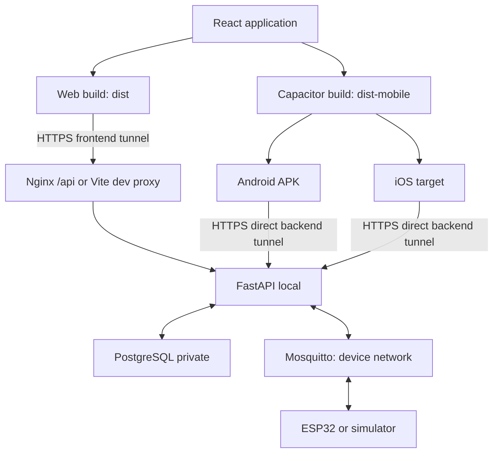

> Cập nhật stabilization 2026-10-06: Android physical runtime và 4G/5G đã được người dùng xác nhận PASS. Bằng chứng manual hiện hành ở mục 11; regression/build mới, git review và kế hoạch commit ở phần Final stabilization cuối báo cáo. Các snapshot/baseline trước đây được giữ để bảo toàn provenance.

# 1. Initial repository state

Branch: `main`. HEAD: `e1219cf7afe5f0709897a6b7c619cb03def36d0f`.

Working tree đã có **67 tracked modified files và 56 untracked files** trước continuation được duyệt, gồm Android/Capacitor chưa commit. Nhiều diff là CRLF, một số là thay đổi nội dung quan trọng. Không reset/stash/clean/checkout/discard; không commit/push/merge.

Snapshot trước implementation: `logs/audits/remote-capacitor-2026-10-06/` (ignored): `git-status-before.txt`, `git-diff-stat-before.txt`, `git-diff-before.patch`, `baseline.json`, bản sao 123 files. Chỉ dùng Git read-only. Baseline này tính từ lúc tiếp tục sau audit được chấp nhận; nó đã chứa task.txt ignore, sửa log routing và audit ở giai đoạn trước. Không gọi các thay đổi đó là code mới của continuation hoặc nhận là do người dùng viết.

Yêu cầu mới của người dùng thay thế đề xuất Expo trong task.txt: ưu tiên React + Capacitor; audit và build Android có sẵn trước khi quyết định mobile.

# 2. Architecture before

React 19.1.1 + Vite 7.1.2 + TypeScript 5.8.3; Web `/api` qua Nginx/Vite -> FastAPI -> PostgreSQL/Mosquitto -> simulator/ESP32. Demo chính trước đây yêu cầu browser phone dùng IP LAN laptop. Backend REST; chưa có WebSocket/WSS/SSE. Firmware mới là README, simulator có implementation safety.

Thực tế khác task.txt: đã có `@capacitor/core`, CLI, Android 8.5.2, `frontend/capacitor.config.ts`, Android project với BridgeActivity. Native scaffold đã đóng gói được UI React có telemetry/device state/history/pump controls, nhưng chưa có public HTTPS API config và chưa có bằng chứng phone runtime. Chưa có iOS target/package.

# 3. Architecture after



Web vẫn chạy local và remote; native dùng **public backend HTTPS URL trực tiếp**, không qua frontend tunnel hoặc MQTT. Android/iOS cùng React components/API/types/command semantics. LAN chỉ dành cho đường thiết bị -> MQTT khi cần.

# 4. Phase 1 — Cloudflare changes

Giữ `/api` Web proxy để cùng origin hoạt động local/remote. Thêm API env resolver (`VITE_API_URL`, giữ alias cũ), mixed-content guard, CORS comma-separated explicit origins, Nginx forwarded scheme/client headers. Không thay Uvicorn trusted proxy mặc định thành wildcard; hiện không có absolute redirect/WebSocket cần mở rộng trust.

Hai scripts PowerShell chạy Quick Tunnel loopback 8000/5173, configurable port/protocol/binary; rewrite Host localhost giữ Vite host allow-list. Thêm `compose.device.yaml` chỉ mở MQTT LAN, giữ `compose.lan.yaml` legacy và đánh dấu DEPRECATED FOR USER ACCESS. PostgreSQL/API/frontend mặc định loopback; không tunnel DB/MQTT.

Config/env/docs thống nhất remote demo. Thêm test image/Compose profile để chạy toàn bộ existing E2E với real DB/MQTT; không overwrite .env hoặc credentials có sẵn. Cloudflare Windows binary 2026.10.0 tải vào ignored logs, không cài global hoặc đổi policy/DNS hệ thống.

# 5. Phase 1 test results

| Test | Result | Evidence |
| --- | --- | --- |
| P1-01 Local frontend | PASS | Container healthy; HTML root/assets được phục vụ; React UI tests và Web build pass. Không nhận là test browser vật lý. |
| P1-02 Local backend | PASS | `/health`, `/ready` OK với real PostgreSQL; container healthy. |
| P1-03 Backend tunnel | PASS | Public HTTPS `/health`, `/ready`, OpenAPI; direct backend command E2E 2/2 pass. |
| P1-04 Frontend tunnel | PASS | Public HTTPS HTML/React assets được phục vụ. |
| P1-05 Public frontend -> backend | PASS | Public `/api/health`, `/api/ready`; proxy command E2E ACK+state và OFF 2/2 pass. |
| P1-06 WSS | NOT TESTED | Không có WebSocket trong code; MVP REST polling. Không tạo WS giả để đánh dấu PASS. |
| P1-07 Phone browser 4G/5G | NOT TESTED | Không có phone/network di động để thực hiện. |
| P1-08 Phone browser command | NOT TESTED | HTTP client + simulator qua public tunnel pass; chưa thực hiện flow từ browser trên phone. |
| P1-09 Không LAN dependency cho user | PASS | Active Web `/api`, native public HTTPS config; static scan và native reject tests. |
| P1-10 Regression | PASS | **16 frontend tests, 91 backend tests (không skip), 31 simulator safety tests**, frontend production build. |

Gate implementation Phase 1 đạt: stack local khỏe, public Web/backend path hoạt động, toàn bộ regression qua. Android Mobile App 4G/5G đã được người dùng nghiệm thu; P1-07/P1-08 dành riêng Mobile Browser vẫn NOT TESTED vì người dùng chỉ xác nhận app. Sau gate mới sync/build native.

# 6. Phase 2 — Mobile App changes

Tái sử dụng toàn bộ React hiện có trong Capacitor; không tạo Expo/mobile project mới. Thêm `@capacitor/ios=8.5.2`, target iOS SPM; giữ core/CLI/Android cùng 8.5.2. Tách Web `dist/` và native `dist-mobile/` để Web build không overwrite native bundle.

Native API URL đọc `VITE_API_URL` tại build-time, từ process env hoặc `.env.mobile.local` ignored. Builder kiểm tra HTTPS origin và actual `/health`/OpenAPI command endpoint trước build; nhầm frontend URL hoặc tunnel chết sẽ fail. Native resolver từ chối relative `/api`, HTTP, LAN/private host, localhost API. `capacitor.config` không có `server.url`; app đóng gói assets, không browser shortcut.

UI giữ telemetry temperature/humidity/soil, history, device MANUAL/AUTO + relay, ON/OFF, pending/applied/rejected/timeout và reasons. Networking tập trung trong api.ts; timeout 10s, hủy khi cleanup, retry GET command status tối đa 5 lỗi liên tiếp, refresh cho phép hồi phục. Không retry POST ON. Giữ semantics `applied` do backend xác nhận ACK + state, không suy từ HTTP 202.

# 7. Mobile technology decision

**KEEP CAPACITOR.** React hiện có tái sử dụng được; Android baseline và final đều build thành công; API layer cấu hình environment; backend HTTPS/CORS hoạt động; không phát hiện blocker kiến trúc. Đây là bằng chứng đủ để ưu tiên stack hiện có theo rule của người dùng, tránh viết lại UI/business logic.

Android là APK với native Capacitor runtime + bundled React assets. iOS dùng cùng codebase, chỉ có native template/config riêng. Không có bằng chứng để đề xuất REPLACE CAPACITOR hoặc Expo.

# 8. Files changed

Các file có task delta so với snapshot continuation dưới đây. Mỗi file pre-existing còn lại được liệt kê ở bảng protection cuối báo cáo và không sửa trong continuation.

| File | What changed / Why |
| --- | --- |
| `.env.example` | Thêm VITE_API_URL/CORS; giữ port, DB/MQTT env và alias cũ. |
| `.gitignore` | Giữ ignore log/task.txt đã có trước continuation; thêm dist-mobile và exception mobile env example. |
| `CLAUDE.md` | Cập nhật quyết định kiến trúc; giữ hướng dẫn và safety hiện có. |
| `README.md` | Remote demo/Capacitor là chính; giữ lịch sử LAN có nhãn deprecated. |
| `backend/.env.example` | Config backend mẫu, không secret. |
| `backend/Dockerfile.tests` | Runner full backend tests với dependencies dev và user không root. |
| `backend/Dockerfile.tests.dockerignore` | Cho phép test context riêng mà không sửa ignore backend có sẵn. |
| `backend/README.md` | Tài liệu CORS/proxy/test; giữ endpoints và contract. |
| `backend/app/config.py` | Thêm CORS_ORIGINS; giữ toàn bộ DB/MQTT/safety settings. |
| `backend/app/http_config.py` | CORS explicit origins configurable, không wildcard. |
| `backend/app/main.py` | Chỉ nối CORS middleware; không đổi control/lifespan. |
| `backend/requirements-dev.txt` | Thêm httpx 0.28.1 cho CORS tests; giữ pytest. |
| `backend/tests/test_http_config.py` | 7 tests CORS/preflight/env/reject wildcard. |
| `compose.device.yaml` | Chỉ MQTT bind LAN cho ESP32; user services vẫn loopback. |
| `compose.lan.yaml` | Chỉ sửa comments deprecated; giữ nguyên ports/legacy semantics. |
| `compose.test.yaml` | Regression runner dùng real stack, isolated device IDs và simulator mount read-only. |
| `compose.yaml` | Thêm env/build args; giữ services, volumes, DB credentials và loopback defaults. |
| `docs/AUDIT_REMOTE_MOBILE_2026-10-06.md` | Audit tạo ở giai đoạn trước; chỉ thêm thông báo quyết định đã được duyệt/thay thế. |
| `docs/INTERFACES.md` | Chỉ cập nhật đoạn architecture; giữ nguyên phần MQTT/API safety contract. |
| `docs/PROJECT_STATE.md` | Thêm quyết định hiện tại; giữ lịch sử milestone. |
| `docs/REMOTE_DEMO.md` | Hướng dẫn Windows, Web/mobile, regression, 4G và iOS. |
| `docs/REMOTE_MOBILE_REPORT_2026-10-06.md` | Báo cáo review/test/provenance của task. |
| `docs/ROADMAP.md` | Thêm quyết định Cloudflare/Capacitor; giữ lịch sử roadmap. |
| `docs/assignments/B-BACKEND.md` | Thêm hướng demo hiện tại; giữ yêu cầu/backend acceptance cũ. |
| `docs/assignments/C-FRONTEND-AI.md` | Thêm hướng demo hiện tại; giữ yêu cầu/frontend acceptance cũ. |
| `frontend/.dockerignore` | Thêm native directories/dist-mobile để build Web không kéo outputs native. |
| `frontend/.env.example` | Web API env mẫu tương thích /api. |
| `frontend/.env.mobile.example` | HTTPS backend env mẫu; URL để trống và local file ignored. |
| `frontend/Dockerfile` | VITE_API_URL và npm ci; giữ test/build/Nginx pipeline. |
| `frontend/README.md` | Remote/mobile build instructions; giữ lịch sử LAN/Android. |
| `frontend/capacitor.config.ts` | Giữ appId/appName; webDir riêng và asset origins rõ ràng; không server.url. |
| `frontend/ios/.gitignore` | Target iOS/template Capacitor 8.5.2 mới; dùng chung React, không business logic riêng. |
| `frontend/ios/App/App.xcodeproj/project.pbxproj` | Target iOS/template Capacitor 8.5.2 mới; dùng chung React, không business logic riêng. |
| `frontend/ios/App/App.xcodeproj/project.xcworkspace/xcshareddata/IDEWorkspaceChecks.plist` | Target iOS/template Capacitor 8.5.2 mới; dùng chung React, không business logic riêng. |
| `frontend/ios/App/App/AppDelegate.swift` | Target iOS/template Capacitor 8.5.2 mới; dùng chung React, không business logic riêng. |
| `frontend/ios/App/App/Assets.xcassets/AppIcon.appiconset/AppIcon-512@2x.png` | Target iOS/template Capacitor 8.5.2 mới; dùng chung React, không business logic riêng. |
| `frontend/ios/App/App/Assets.xcassets/AppIcon.appiconset/Contents.json` | Target iOS/template Capacitor 8.5.2 mới; dùng chung React, không business logic riêng. |
| `frontend/ios/App/App/Assets.xcassets/Contents.json` | Target iOS/template Capacitor 8.5.2 mới; dùng chung React, không business logic riêng. |
| `frontend/ios/App/App/Assets.xcassets/Splash.imageset/Contents.json` | Target iOS/template Capacitor 8.5.2 mới; dùng chung React, không business logic riêng. |
| `frontend/ios/App/App/Assets.xcassets/Splash.imageset/splash-2732x2732-1.png` | Target iOS/template Capacitor 8.5.2 mới; dùng chung React, không business logic riêng. |
| `frontend/ios/App/App/Assets.xcassets/Splash.imageset/splash-2732x2732-2.png` | Target iOS/template Capacitor 8.5.2 mới; dùng chung React, không business logic riêng. |
| `frontend/ios/App/App/Assets.xcassets/Splash.imageset/splash-2732x2732.png` | Target iOS/template Capacitor 8.5.2 mới; dùng chung React, không business logic riêng. |
| `frontend/ios/App/App/Base.lproj/LaunchScreen.storyboard` | Target iOS/template Capacitor 8.5.2 mới; dùng chung React, không business logic riêng. |
| `frontend/ios/App/App/Base.lproj/Main.storyboard` | Target iOS/template Capacitor 8.5.2 mới; dùng chung React, không business logic riêng. |
| `frontend/ios/App/App/Info.plist` | Target iOS/template Capacitor 8.5.2 mới; dùng chung React, không business logic riêng. |
| `frontend/ios/App/App/SceneDelegate.swift` | Target iOS/template Capacitor 8.5.2 mới; dùng chung React, không business logic riêng. |
| `frontend/ios/App/CapApp-SPM/.gitignore` | Target iOS/template Capacitor 8.5.2 mới; dùng chung React, không business logic riêng. |
| `frontend/ios/App/CapApp-SPM/Package.swift` | Target iOS/template Capacitor 8.5.2 mới; dùng chung React, không business logic riêng. |
| `frontend/ios/App/CapApp-SPM/README.md` | Target iOS/template Capacitor 8.5.2 mới; dùng chung React, không business logic riêng. |
| `frontend/ios/App/CapApp-SPM/Sources/CapApp-SPM/CapApp-SPM.swift` | Target iOS/template Capacitor 8.5.2 mới; dùng chung React, không business logic riêng. |
| `frontend/ios/debug.xcconfig` | Target iOS/template Capacitor 8.5.2 mới; dùng chung React, không business logic riêng. |
| `frontend/nginx.conf` | Thêm forwarded scheme/client headers; giữ /api routing hiện có. |
| `frontend/package-lock.json` | Chỉ thêm @capacitor/ios 8.5.2; 309 package versions có sẵn không đổi. |
| `frontend/package.json` | Giữ dependencies/scripts hiện có; thêm iOS và mobile build/sync scripts. |
| `frontend/scripts/build-mobile.mjs` | Validate backend HTTPS health/OpenAPI trước build dist-mobile; lỗi exit 1 rõ ràng. |
| `frontend/src/App.test.tsx` | Giữ 5 tests cũ; thêm 3 tests timeout/reject/recovery không replay POST. |
| `frontend/src/App.tsx` | Giữ UI/safety/status semantics; giới hạn retry GET và cho refresh hồi phục. |
| `frontend/src/api.network.test.ts` | 2 tests request timeout và POST lỗi không retry. |
| `frontend/src/api.ts` | Giữ endpoints/types/command payloads; cấu hình URL và timeout/cancellation tập trung. |
| `frontend/src/apiConfig.test.ts` | 6 tests config, native HTTPS/public origin và mixed content. |
| `frontend/src/apiConfig.ts` | Resolver dùng chung Web/native; guard localhost/LAN/relative API native. |
| `frontend/src/vite-env.d.ts` | Thêm type VITE_API_URL; giữ alias hiện có. |
| `infra/README.md` | Thêm device LAN/remote distinction; giữ setup hiện có. |
| `scripts/start-backend-tunnel.ps1` | Quick Tunnel backend, loopback origin, port/protocol/binary configurable. |
| `scripts/start-frontend-tunnel.ps1` | Quick Tunnel frontend, Host localhost để giữ Vite allow-list. |

Ngoài Git-visible files: generated Web/native assets, APK, binary cloudflared và audit snapshots nằm trong paths ignored. 30 JVM crash/replay logs đã được dời khỏi root sang `logs/java/` ở giai đoạn trước; wrappers giữ crash outputs tại đó. `/task.txt` đã ignore. Không xóa crash logs.

# 9. Environment variables

| Client/service | Variables / Behavior |
| --- | --- |
| Web | `VITE_API_URL` ưu tiên hơn `VITE_API_BASE_URL`; mặc định `/api`. Optional absolute HTTP local hoặc HTTPS public; HTTPS Web không gọi HTTP API. |
| Backend | `CORS_ORIGINS`: comma-separated exact origins. Defaults `http://localhost:5173,http://127.0.0.1:5173,https://localhost,capacitor://localhost`. Empty disables cross-origin allowance; wildcard bị reject. |
| Native | `VITE_API_URL` = HTTPS **backend origin** hiện tại; `.env.mobile.local` hoặc env của process. Alias cũ hỗ trợ nhưng phải đáp ứng public HTTPS. Build-time: tunnel URL đổi cần sync/build/install lại. |
| Existing infra | DB/MQTT env, credentials, ports và safety settings giữ nguyên. `.env` actual không chỉnh/print/commit. |

Không WS_URL/VITE_WS_URL vì chưa có WS. Không Cloudflare token/account/domain. Examples không chứa URL tunnel thực tế. Native asset origins localhost là origin nội bộ app, không địa chỉ laptop API.

# 10. MQTT safety verification

**UNCHANGED.** Không đổi topic `garden/<id>/{telemetry,control,ack,state}` hoặc MQTT transport/control logic. repository.py, mqtt_bridge.py, ingest.py, schemas.py, SQL migrations, toàn bộ simulator implementation/tests giữ nguyên byte so với snapshot. Manual/Auto, expires_at, target_boot_id, clock_unsynced, pump_off priority, stale/timeout/replay protections giữ nguyên.

91 backend tests gồm command/deadline race/E2E với DB/MQTT thật và 31 simulator tests pass. Public proxy và direct backend E2E riêng xác nhận applied chỉ sau ACK + matching state, OFF phải relay-off state. Dùng e2e_* device IDs, không bật pump node_01 hoặc phần cứng. Client không publish MQTT, không tự replay POST khi reconnect/error.

# 11. Android status

Architecture/config: **READY**. Phiên implementation trước: baseline/final `assembleDebug` **PASS**, `BUILD SUCCESSFUL in 46s`, 93 tasks. Build stabilization hiện hành được ghi ở phần Final stabilization cuối báo cáo. JDK 21; Gradle 8.14.3; compile/target SDK 36; min SDK 24. SDK XML mismatch/flatDir warnings không làm build fail.

Artifact của phiên implementation trước (không phải hash APK người dùng xác nhận): `frontend/android/app/build/outputs/apk/debug/app-debug.apk`, 4,279,437 bytes. SHA-256: `e0bbfcb42a56bafceef09a0874465787bb7ab5f2ade9f235e577d319de8c794b`.

ZIP kiểm tra bundled assets bằng byte với dist-mobile, Android copied assets và iOS copied assets: PASS; appId `com.aiot.smartgarden`, không remote server.url. APK này được build với backend URL kiểm thử còn sống tại thời điểm build; sau khi đóng/restart tunnel phải đổi local env, build và install APK mới.

Ở phiên automated trước, `adb devices -l` không có thiết bị. Evidence này đã được bổ sung bằng xác nhận người dùng: **MANUAL DEVICE TEST — User-confirmed on physical Android device (2026-10-06, Asia/Bangkok).** Người dùng xác nhận APK cài/chạy trên Android thật, tắt Wi-Fi và dùng 4G/5G; telemetry/state, pump ON/OFF, Web/App shared state và ACK + state lifecycle đều PASS. Đây là **USER-CONFIRMED MANUAL TEST**, không phải automated test; không suy ra phone browser 4G, network recovery, iOS hoặc phần cứng ESP32 đã được kiểm thử. Debug APK chưa là release signed/Play Store build.

| Manual device evidence | Result | Source |
| --- | --- | --- |
| Android APK runtime | PASS | USER-CONFIRMED MANUAL TEST; APK cài và chạy thành công |
| Android 4G/5G remote access | PASS | Wi-Fi OFF, dữ liệu 4G/5G ON, backend qua Cloudflare |
| Telemetry over Internet | PASS | User-confirmed on physical Android device |
| Device/state synchronization | PASS | User-confirmed on physical Android device |
| Pump ON command | PASS | User-confirmed on physical Android device |
| Pump OFF command | PASS | User-confirmed on physical Android device |
| Web/Mobile shared state | PASS | Web và Mobile App cùng state |
| Command ACK + state lifecycle | PASS | Command qua backend/MQTT; ACK và state phản ánh đúng |

Không có timestamp chi tiết, model phone, Android version hoặc hash APK người dùng đã cài trong xác nhận; không tự bổ sung dữ liệu này. Hash build mới chỉ là artifact của regression, không gán cho APK đã manual test.

| Test | Result | Evidence |
| --- | --- | --- |
| M-01 (đổi từ Expo start thành Capacitor build/sync) | PASS | Automated build/sync/APK; install/launch PASS — MANUAL DEVICE TEST, user-confirmed on physical Android device. |
| M-02 Android app gọi HTTPS FastAPI | PASS | MANUAL DEVICE TEST — người dùng xác nhận Mobile App gọi backend qua Cloudflare trên Android thật. |
| M-03 Android 4G/5G telemetry | PASS | MANUAL DEVICE TEST — Wi-Fi OFF, 4G/5G ON; telemetry Internet hiển thị. |
| M-04 App device state | PASS | MANUAL DEVICE TEST — state hiển thị và Web/Mobile App đồng bộ cùng state. |
| M-05 App pump command | PASS | MANUAL DEVICE TEST — pump ON PASS và pump OFF PASS trên Android thật qua 4G/5G. |
| M-06 App -> API -> MQTT -> ACK/state -> app | PASS | MANUAL DEVICE TEST — command đi qua backend/MQTT; ACK + state phản ánh đúng và đồng bộ Web/App. |
| M-07 Timeout/reject/error/recovery UI | PASS | Unit tests cho timeout/reject/recovery, request timeout và không replay POST; native runtime NOT TESTED. |
| M-08 Không hard-code LAN API | PASS | Native URL guard/tests/static scan. |
| M-09 Không hard-code actual Quick Tunnel URL | PASS | Random runtime URLs chỉ ở ignored logs/env/generated build artifacts. |
| M-10 iOS architecture/config | PASS | Target/SPM/package/CORS/assets inspected; build/runtime NOT TESTED. |

# 12. iOS status

**iOS architecture/config: READY. iOS build: NOT TESTED. iOS runtime: NOT TESTED.**

Target đã tạo, deployment iOS 15.0, SPM exact Capacitor 8.5.2, appId thống nhất, native assets copied/configured. Info.plist parse hợp lệ, không thêm `NSAllowsArbitraryLoads` hoặc HTTP ATS exception; HTTPS backend. Không có macOS/Xcode ở môi trường này. Signing/team, compile và simulator/device vẫn phải xác minh trên Mac. Capacitor v8 yêu cầu Xcode 26+ theo [official iOS setup](https://capacitorjs.com/docs/ios).

# 13. Remaining LAN references

Static scan Git-visible source/docs được lưu ở `logs/audits/remote-capacitor-2026-10-06/final-network-search.txt`; full broad Phase 0 scan cũng retained. Không scan node_modules/.git/build/log outputs như source.

| Remaining reference | Reason |
| --- | --- |
| `frontend/src/apiConfig.test.ts` private IP literals | Negative test inputs (192.168.1.2, 10.0.0.2, 172.16.0.2, loopback), phải reject; không runtime API config. |
| `compose.device.yaml` 0.0.0.0:1883 | ESP32 -> MQTT trong mạng thiết bị; không publish Internet hoặc tunnel 1883. |
| `compose.lan.yaml`, old README LAN sections | Giữ legacy semantics/pre-existing history, gắn DEPRECATED FOR USER ACCESS. Không dùng làm demo chính. |
| docs historical PR/BOOTSTRAP/assignments/M1, simulator/firmware/infra notes | Lịch sử acceptance/dev hoặc ESP32 -> MQTT; không xóa/viết lại pre-existing history. Current architecture notice ưu tiên Cloudflare. |
| `ipconfig`, `<IP_LAN_LAPTOP>` documentation | Broker device configuration hoặc legacy/example; không dùng làm API URL native. |
| localhost/127.0.0.1 in local env, compose, Vite proxy, test helpers, tunnel scripts | Local development/origin/service health/tests; giữ local development. |
| `https://localhost`, `capacitor://localhost` | Native bundled WebView origins + exact CORS allowance; không laptop backend. |

Không có personal LAN IP trong active app config; không Expo env/project. Firmware actual connection chưa test vì repo chưa implement firmware.

# 14. Security notes

Quick Tunnels chỉ demo/dev, URL tạm và người biết URL truy cập được service; không production deployment. [Cloudflare Quick Tunnels](https://developers.cloudflare.com/tunnel/get-started/quick-tunnels/). Backend chưa có authentication; CORS không phải authorization. Không thêm auth redesign trong task.

User endpoints public qua HTTPS trong phiên demo; DB giữ loopback, broker chỉ device LAN. Broker hiện anonymous theo config pre-existing, chỉ dùng mạng thiết bị tin cậy. Main Android manifest không global cleartext bypass, có INTERNET permission; debug-only pre-existing cleartext=true giữ nguyên byte, native API resolver vẫn bắt buộc HTTPS. Không network security config riêng. iOS ATS mặc định.

Không secret/token/actual tunnel URL đưa vào Git-visible source hoặc report. `.env`, `.env.mobile.local`, logs, dist-mobile, APK/native generated public/config outputs ignored. Không mở wildcard CORS, Vite allowedHosts hoặc trusted proxies.

# 15. Remaining limitations

Android physical runtime/4G/5G, telemetry/state, ON/OFF, Web/App sync và ACK + state đã PASS bằng USER-CONFIRMED MANUAL TEST. Mobile Browser 4G/5G (P1-07/P1-08), manual network recovery/timeout/reject, iOS build/runtime và ESP32 thật chưa được xác nhận. Definition of Done của phase này dùng Android evidence và giữ iOS runtime NOT TESTED; không suy rộng sang phần cứng thật hoặc production.

Quick Tunnel không có URL ổn định/SLA. Đã gặp laptop đổi/mất mạng làm tunnel cũ hết DNS và `Unauthorized: Tunnel not found`; tạo tunnel mới và rebuild mobile giải quyết, không sửa source hoặc DNS hệ thống. Mỗi lần backend tunnel URL đổi cần rebuild/reinstall native. Không background execution/push/release signing/PWA implementation mới.

Hai Quick Tunnels của phiên verification trước đã được đóng; người dùng sau đó xác nhận phiên Android remote thực tế PASS. Không kiểm tra lại tunnel live trong stabilization. Quick Tunnel có thể đóng/đổi URL; nếu backend URL thay đổi cần cập nhật local env, sync/build/install cho lần demo tiếp theo.

# 16. Manual test procedure

1. Chạy infrastructure/backend/frontend theo Terminal 1 trong [REMOTE_DEMO](REMOTE_DEMO.md#terminal-1--infrastructure--backend--frontend); kiểm tra health/ready và tất cả containers healthy. Không copy đè .env hoặc xóa volumes.
2. Chạy simulator node_01 hoặc ESP32 có telemetry/state; phân biệt simulated=true với sensor thật. ESP32 vẫn cùng mạng với broker nếu MQTT local.
3. Mở backend và frontend tunnels, lấy hai URLs mới. Backend `/health`, `/ready` phải JSON OK; frontend có dashboard và `/api/health` OK. Giữ terminals chạy.
4. Phone browser: tắt Wi-Fi, bật 4G/5G, mở frontend URL; đọc telemetry và mode/relay. Gửi ON 5s, xem pending rồi applied chỉ khi ACK + state khớp, OFF phải state OFF. Ghi kết quả P1-07/08.
5. Native: đặt VITE_API_URL bằng **backend** URL, `npm run android:sync`, Gradle assembleDebug, adb install/launch. Tắt Wi-Fi, xác nhận telemetry/state và ON/OFF lifecycle; không coi POST 202 là pump bật. Ghi APK/hash, thời điểm và URL trong local log.
6. Ngắt mạng phone, chờ request timeout/error, nối lại và nhấn Làm mới. Không tự gửi lại POST ON cũ. Dùng device test riêng để kiểm timeout (không ACK) và rejection clock_unsynced; không can thiệp clock/safety node demo ngoài ý muốn.
7. Trên Mac: `npm ci`, local mobile env URL còn sống, `npm run ios:sync`, `npx cap open ios`, chọn signing team/device/simulator rồi build/run và lặp lại API/safety checks. Ghi iOS build/runtime riêng.
8. Kết thúc demo đóng hai tunnel; giữ dữ liệu DB. Mỗi bước chỉ đánh PASS sau kiểm tra thực tế, lưu evidence.

# 17. Exact Windows commands

Các lệnh đầy đủ có thể copy trực tiếp ở [REMOTE_DEMO.md](REMOTE_DEMO.md): Terminal 1 infrastructure + backend + frontend; Terminal 2 simulator; Terminal 3 backend tunnel; Terminal 4 frontend tunnel; Terminal 5 Android. Không có Expo terminal. Local development Vite là lựa chọn thay container frontend cùng port.

Lệnh regression/build chính từ root (PowerShell):

```powershell
docker compose -f compose.yaml -f compose.device.yaml up --build -d
Invoke-RestMethod http://127.0.0.1:8000/health
Invoke-RestMethod http://127.0.0.1:8000/ready
# Mỗi tunnel chạy ở terminal riêng:
powershell -NoProfile -ExecutionPolicy Bypass -File scripts/start-backend-tunnel.ps1 -CloudflaredPath .\logs\cloudflared-windows-amd64.exe -Protocol http2
powershell -NoProfile -ExecutionPolicy Bypass -File scripts/start-frontend-tunnel.ps1 -CloudflaredPath .\logs\cloudflared-windows-amd64.exe -Protocol http2
# Terminal build/test:
Push-Location frontend
npm ci
npm test
npm run build
$env:VITE_API_URL = (Read-Host "Paste current BACKEND HTTPS Quick Tunnel URL").TrimEnd('/')
npm run android:sync
if (-not $env:ANDROID_HOME) { $env:ANDROID_HOME = "$env:LOCALAPPDATA\Android\Sdk" }
Push-Location android
.\gradlew.bat assembleDebug --no-daemon --max-workers=2
Pop-Location
& "$env:ANDROID_HOME\platform-tools\adb.exe" devices -l
# Chỉ khi có đúng một phone authorize USB debugging:
& "$env:ANDROID_HOME\platform-tools\adb.exe" install -r android/app/build/outputs/apk/debug/app-debug.apk
& "$env:ANDROID_HOME\platform-tools\adb.exe" shell am start -n com.aiot.smartgarden/.MainActivity
Pop-Location
docker compose -f compose.yaml -f compose.device.yaml -f compose.test.yaml --profile tests run --build --rm regression-tests
```

Thực tế build host dùng SDK `C:\Users\nguye\AppData\Local\Android\Sdk`, JDK 21 đã có. Không overwrite SDK config hoặc .env người dùng. Trong repo có cả hai wrappers; Windows dùng gradlew.bat. Khi không có device thì dừng trước adb install/launch và ghi NOT TESTED.

# 18. Git diff summary

Task delta so với 123-file continuation snapshot: **28 MIXED files**, **37 TASK CHANGES files**, **95 PRE-EXISTING files giữ nguyên byte**, **0 baseline files bị xóa**. Toàn bộ 54 pre-existing Android source/build config files giữ nguyên byte. 309 existing locked dependency versions không đổi. Existing backend/simulator safety implementation giữ nguyên.

`git diff --stat` dưới đây so với HEAD gồm cả pre-existing changes/CRLF; không dùng nó để nhận tất cả edits là task của mình. Git không tính untracked native/new files trong stat. Delta continuation có trong ignored `task-delta-normalized.patch` (chỉ normalize CRLF khi so sánh, không normalize files thực tế), `final-file-classification.json` và snapshot.

```text
 .env.example                                 |   50 +-
 .github/ISSUE_TEMPLATE/task.md               |   80 +-
 .github/pull_request_template.md             |   48 +-
 .gitignore                                   |  116 +-
 CLAUDE.md                                    |  432 +-
 README.md                                    |  383 +-
 ai/README.md                                 |   26 +-
 backend/.dockerignore                        |   14 +-
 backend/Dockerfile                           |   40 +-
 backend/README.md                            |  270 +-
 backend/app/__init__.py                      |    4 +-
 backend/app/config.py                        |  130 +-
 backend/app/db.py                            |  110 +-
 backend/app/ingest.py                        |  244 +-
 backend/app/main.py                          |  774 +--
 backend/app/migrations/001_telemetry.sql     |   58 +-
 backend/app/migrations/002_commands.sql      |   92 +-
 backend/app/migrations/003_g02_contract.sql  |  166 +-
 backend/app/mqtt_bridge.py                   |  186 +-
 backend/app/repository.py                    | 1134 ++--
 backend/app/schemas.py                       |  586 +-
 backend/requirements-dev.txt                 |    5 +-
 backend/requirements.txt                     |   10 +-
 backend/tests/e2e/helpers.py                 |  596 +--
 backend/tests/e2e/test_backend_e2e.py        |  308 +-
 backend/tests/e2e/test_g02_contract.py       | 1020 ++--
 backend/tests/e2e/test_g02_deadline_races.py |  390 +-
 backend/tests/test_validation.py             |  588 +-
 compose.lan.yaml                             |   20 +-
 compose.yaml                                 |  216 +-
 docs/BOOTSTRAP_REPORT.md                     |  502 +-
 docs/INTERFACES.md                           | 1120 ++--
 docs/PR2_TEST_HANDOFF_2026-09-26.md          |  196 +-
 docs/PROJECT_STATE.md                        |   28 +-
 docs/ROADMAP.md                              |   51 +-
 docs/TEAM.md                                 |   72 +-
 docs/WORKFLOW.md                             |  134 +-
 docs/assignments/A-EMBEDDED.md               |  370 +-
 docs/assignments/B-BACKEND.md                |  363 +-
 docs/assignments/C-FRONTEND-AI.md            |  371 +-
 docs/templates/WEEKLY_REVIEW.md              |   62 +-
 firmware/README.md                           |   32 +-
 frontend/.dockerignore                       |   18 +-
 frontend/Dockerfile                          |   44 +-
 frontend/README.md                           |   39 +-
 frontend/index.html                          |   34 +-
 frontend/nginx.conf                          |   45 +-
 frontend/package-lock.json                   | 7410 +++++++++++++++-----------
 frontend/package.json                        |   62 +-
 frontend/src/App.test.tsx                    |  774 +--
 frontend/src/App.tsx                         | 1622 +++---
 frontend/src/api.ts                          |  710 +--
 frontend/src/main.tsx                        |   22 +-
 frontend/src/styles.css                      | 2142 ++++----
 frontend/src/test/setup.ts                   |   14 +-
 frontend/src/vite-env.d.ts                   |   21 +-
 frontend/tsconfig.json                       |   44 +-
 frontend/vite.config.ts                      |   34 +-
 frontend/vitest.config.ts                    |   22 +-
 infra/README.md                              |   97 +-
 infra/mosquitto/mosquitto.conf               |   20 +-
 simulator/README.md                          |  228 +-
 simulator/device.py                          |  594 +--
 simulator/requirements.txt                   |    4 +-
 simulator/simulator.py                       |  910 ++--
 simulator/tests/test_device.py               |  686 +--
 simulator/tests/test_simulator.py            |  408 +-
 67 files changed, 14378 insertions(+), 13023 deletions(-)
```

CRLF-aware check `git -c core.whitespace=cr-at-eol diff --check`: PASS. Không thay repo/global Git config. Files new/untracked đã phân loại trong bảng protection; generated/ignored assets không thuộc diff này.

# 19. Git status

HEAD/branch giữ nguyên; không commit/push/stage/merge. Đây là working tree để review, không phải clean tree.

```text
 M .env.example
 M .github/ISSUE_TEMPLATE/task.md
 M .github/pull_request_template.md
 M .gitignore
 M CLAUDE.md
 M README.md
 M ai/README.md
 M backend/.dockerignore
 M backend/Dockerfile
 M backend/README.md
 M backend/app/__init__.py
 M backend/app/config.py
 M backend/app/db.py
 M backend/app/ingest.py
 M backend/app/main.py
 M backend/app/migrations/001_telemetry.sql
 M backend/app/migrations/002_commands.sql
 M backend/app/migrations/003_g02_contract.sql
 M backend/app/mqtt_bridge.py
 M backend/app/repository.py
 M backend/app/schemas.py
 M backend/requirements-dev.txt
 M backend/requirements.txt
 M backend/tests/e2e/helpers.py
 M backend/tests/e2e/test_backend_e2e.py
 M backend/tests/e2e/test_g02_contract.py
 M backend/tests/e2e/test_g02_deadline_races.py
 M backend/tests/test_validation.py
 M compose.lan.yaml
 M compose.yaml
 M docs/BOOTSTRAP_REPORT.md
 M docs/INTERFACES.md
 M docs/PR2_TEST_HANDOFF_2026-09-26.md
 M docs/PROJECT_STATE.md
 M docs/ROADMAP.md
 M docs/TEAM.md
 M docs/WORKFLOW.md
 M docs/assignments/A-EMBEDDED.md
 M docs/assignments/B-BACKEND.md
 M docs/assignments/C-FRONTEND-AI.md
 M docs/templates/WEEKLY_REVIEW.md
 M firmware/README.md
 M frontend/.dockerignore
 M frontend/Dockerfile
 M frontend/README.md
 M frontend/index.html
 M frontend/nginx.conf
 M frontend/package-lock.json
 M frontend/package.json
 M frontend/src/App.test.tsx
 M frontend/src/App.tsx
 M frontend/src/api.ts
 M frontend/src/main.tsx
 M frontend/src/styles.css
 M frontend/src/test/setup.ts
 M frontend/src/vite-env.d.ts
 M frontend/tsconfig.json
 M frontend/vite.config.ts
 M frontend/vitest.config.ts
 M infra/README.md
 M infra/mosquitto/mosquitto.conf
 M simulator/README.md
 M simulator/device.py
 M simulator/requirements.txt
 M simulator/simulator.py
 M simulator/tests/test_device.py
 M simulator/tests/test_simulator.py
?? backend/.env.example
?? backend/Dockerfile.tests
?? backend/Dockerfile.tests.dockerignore
?? backend/app/http_config.py
?? backend/tests/test_http_config.py
?? compose.device.yaml
?? compose.test.yaml
?? docs/AUDIT_REMOTE_MOBILE_2026-10-06.md
?? docs/REMOTE_DEMO.md
?? docs/REMOTE_MOBILE_REPORT_2026-10-06.md
?? frontend/.env.example
?? frontend/.env.mobile.example
?? frontend/android/
?? frontend/capacitor.config.ts
?? frontend/ios/
?? frontend/scripts/
?? frontend/src/api.network.test.ts
?? frontend/src/apiConfig.test.ts
?? frontend/src/apiConfig.ts
?? scripts/
```

# Capacitor audit

| Item | Finding / Evidence |
| --- | --- |
| Packages | package.json/lock và installed packages: core/CLI/Android **8.5.2** đã có; iOS **8.5.2** thêm trong task. Không bump các versions cũ. |
| A. Used or scaffold? | Native shell là template BridgeActivity nhưng nối vào React dashboard thật, đóng gói/build được UI chức năng. Trước implementation chưa có bằng chứng native runtime; sau đó người dùng xác nhận physical Android runtime và 4G/5G PASS (MANUAL DEVICE TEST). |
| B. Android build | Baseline và final assembleDebug PASS; APK tồn tại, native assets kiểm bằng byte. |
| C. Current functions | Telemetry/latest/history, temperature/humidity/soil, mode/relay/stale state, system health, pump ON/OFF, command status/reasons và refresh. |
| D. API/networking | Shared api.ts fetch REST, polling; VITE_API_URL env resolver, native direct backend HTTPS. Web /api proxy vẫn hỗ trợ. |
| E. LAN/localhost | Trước task Web/LAN instructions và relative /api không đủ cho native. Sau task native reject LAN/localhost/relative API; internal asset localhost origins retained. |
| F. HTTPS Cloudflare | Có thể và đã verify backend public endpoints/OpenAPI/native-origin CORS cùng simulator command flow; phone fetch runtime PASS bằng USER-CONFIRMED MANUAL TEST. |
| G. iOS target | Trước: chưa có. Sau: target frontend/ios, SPM/iOS 15/config/assets READY; build/runtime NOT TESTED. |
| AndroidManifest/network security | INTERNET permission; main không cleartext bypass; debug-only cleartext=true có sẵn giữ nguyên; không custom network security config. Active API HTTPS enforced. |
| Build output/webDir | Trước dist; sau dist-mobile cho native, dist giữ Web. Không server.url/remote website wrapper. |
| H. Blockers | Không blocker kiến trúc buộc thay Capacitor. iOS chưa có Mac/Xcode/iPhone để verification; URL Quick Tunnel thay đổi là giới hạn demo/config build-time. |

# Mobile decision

**KEEP CAPACITOR.** Evidence: tái sử dụng React hoạt động, real Android APK build thành công trước/sau, HTTP API configurable, direct public backend HTTPS/CORS probes và public command safety flow pass, iOS target dùng cùng codebase. Reasoning: đáp ứng rule chọn stack hiện có với effort nhỏ hơn rewrite; native Android runtime đã có manual evidence; iOS build/runtime còn cần kiểm thử, không phải chứng cứ thay stack. Không tạo Expo và không tự thay Capacitor.

# Pre-existing changes protection

Classification tính theo snapshot trước approved continuation. **PRE-EXISTING** = giữ nguyên byte; **TASK CHANGES** = mới; **MIXED** = file có thay đổi trước đó và merge thêm task delta. Không đồng nhất PRE-EXISTING với tác giả người dùng: wrappers/log ignore/audit là kết quả của giai đoạn trước và được bảo toàn. Trước mỗi sửa file existing đã đọc/có snapshot và chỉ sửa fragment cần thiết; không rewrite để xóa semantics cũ. package-lock được npm cập nhật có kiểm chứng tất cả existing versions giữ nguyên.

File | Pre-existing | Task change | Notes (mọi Git-visible modified/untracked file, mở rộng cả native directories):

| File | Pre-existing | Task change | Notes |
| --- | --- | --- | --- |
| `.env.example` | Có | Có | MIXED — Thêm VITE_API_URL/CORS; giữ port, DB/MQTT env và alias cũ. |
| `.github/ISSUE_TEMPLATE/task.md` | Có | Không | PRE-EXISTING — Giữ nguyên byte so với snapshot continuation; không sửa trong implementation này. |
| `.github/pull_request_template.md` | Có | Không | PRE-EXISTING — Giữ nguyên byte so với snapshot continuation; không sửa trong implementation này. |
| `.gitignore` | Có | Có | MIXED — Giữ ignore log/task.txt đã có trước continuation; thêm dist-mobile và exception mobile env example. |
| `CLAUDE.md` | Có | Có | MIXED — Cập nhật quyết định kiến trúc; giữ hướng dẫn và safety hiện có. |
| `README.md` | Có | Có | MIXED — Remote demo/Capacitor là chính; giữ lịch sử LAN có nhãn deprecated. |
| `ai/README.md` | Có | Không | PRE-EXISTING — Giữ nguyên byte so với snapshot continuation; không sửa trong implementation này. |
| `backend/.dockerignore` | Có | Không | PRE-EXISTING — Giữ nguyên byte so với snapshot continuation; không sửa trong implementation này. |
| `backend/.env.example` | Không | Có | TASK CHANGES — Config backend mẫu, không secret. |
| `backend/Dockerfile` | Có | Không | PRE-EXISTING — Giữ nguyên byte so với snapshot continuation; không sửa trong implementation này. |
| `backend/Dockerfile.tests` | Không | Có | TASK CHANGES — Runner full backend tests với dependencies dev và user không root. |
| `backend/Dockerfile.tests.dockerignore` | Không | Có | TASK CHANGES — Cho phép test context riêng mà không sửa ignore backend có sẵn. |
| `backend/README.md` | Có | Có | MIXED — Tài liệu CORS/proxy/test; giữ endpoints và contract. |
| `backend/app/__init__.py` | Có | Không | PRE-EXISTING — Giữ nguyên byte so với snapshot continuation; không sửa trong implementation này. |
| `backend/app/config.py` | Có | Có | MIXED — Thêm CORS_ORIGINS; giữ toàn bộ DB/MQTT/safety settings. |
| `backend/app/db.py` | Có | Không | PRE-EXISTING — Giữ nguyên byte so với snapshot continuation; không sửa trong implementation này. |
| `backend/app/http_config.py` | Không | Có | TASK CHANGES — CORS explicit origins configurable, không wildcard. |
| `backend/app/ingest.py` | Có | Không | PRE-EXISTING — Giữ nguyên byte so với snapshot continuation; không sửa trong implementation này. |
| `backend/app/main.py` | Có | Có | MIXED — Chỉ nối CORS middleware; không đổi control/lifespan. |
| `backend/app/migrations/001_telemetry.sql` | Có | Không | PRE-EXISTING — Giữ nguyên byte so với snapshot continuation; không sửa trong implementation này. |
| `backend/app/migrations/002_commands.sql` | Có | Không | PRE-EXISTING — Giữ nguyên byte so với snapshot continuation; không sửa trong implementation này. |
| `backend/app/migrations/003_g02_contract.sql` | Có | Không | PRE-EXISTING — Giữ nguyên byte so với snapshot continuation; không sửa trong implementation này. |
| `backend/app/mqtt_bridge.py` | Có | Không | PRE-EXISTING — Giữ nguyên byte so với snapshot continuation; không sửa trong implementation này. |
| `backend/app/repository.py` | Có | Không | PRE-EXISTING — Giữ nguyên byte so với snapshot continuation; không sửa trong implementation này. |
| `backend/app/schemas.py` | Có | Không | PRE-EXISTING — Giữ nguyên byte so với snapshot continuation; không sửa trong implementation này. |
| `backend/requirements-dev.txt` | Có | Có | MIXED — Thêm httpx 0.28.1 cho CORS tests; giữ pytest. |
| `backend/requirements.txt` | Có | Không | PRE-EXISTING — Giữ nguyên byte so với snapshot continuation; không sửa trong implementation này. |
| `backend/tests/e2e/helpers.py` | Có | Không | PRE-EXISTING — Giữ nguyên byte so với snapshot continuation; không sửa trong implementation này. |
| `backend/tests/e2e/test_backend_e2e.py` | Có | Không | PRE-EXISTING — Giữ nguyên byte so với snapshot continuation; không sửa trong implementation này. |
| `backend/tests/e2e/test_g02_contract.py` | Có | Không | PRE-EXISTING — Giữ nguyên byte so với snapshot continuation; không sửa trong implementation này. |
| `backend/tests/e2e/test_g02_deadline_races.py` | Có | Không | PRE-EXISTING — Giữ nguyên byte so với snapshot continuation; không sửa trong implementation này. |
| `backend/tests/test_http_config.py` | Không | Có | TASK CHANGES — 7 tests CORS/preflight/env/reject wildcard. |
| `backend/tests/test_validation.py` | Có | Không | PRE-EXISTING — Giữ nguyên byte so với snapshot continuation; không sửa trong implementation này. |
| `compose.device.yaml` | Không | Có | TASK CHANGES — Chỉ MQTT bind LAN cho ESP32; user services vẫn loopback. |
| `compose.lan.yaml` | Có | Có | MIXED — Chỉ sửa comments deprecated; giữ nguyên ports/legacy semantics. |
| `compose.test.yaml` | Không | Có | TASK CHANGES — Regression runner dùng real stack, isolated device IDs và simulator mount read-only. |
| `compose.yaml` | Có | Có | MIXED — Thêm env/build args; giữ services, volumes, DB credentials và loopback defaults. |
| `docs/AUDIT_REMOTE_MOBILE_2026-10-06.md` | Có | Có | MIXED — Audit tạo ở giai đoạn trước; chỉ thêm thông báo quyết định đã được duyệt/thay thế. |
| `docs/BOOTSTRAP_REPORT.md` | Có | Không | PRE-EXISTING — Giữ nguyên byte so với snapshot continuation; không sửa trong implementation này. |
| `docs/INTERFACES.md` | Có | Có | MIXED — Chỉ cập nhật đoạn architecture; giữ nguyên phần MQTT/API safety contract. |
| `docs/PR2_TEST_HANDOFF_2026-09-26.md` | Có | Không | PRE-EXISTING — Giữ nguyên byte so với snapshot continuation; không sửa trong implementation này. |
| `docs/PROJECT_STATE.md` | Có | Có | MIXED — Thêm quyết định hiện tại; giữ lịch sử milestone. |
| `docs/REMOTE_DEMO.md` | Không | Có | TASK CHANGES — Hướng dẫn Windows, Web/mobile, regression, 4G và iOS. |
| `docs/REMOTE_MOBILE_REPORT_2026-10-06.md` | Không | Có | TASK CHANGES — Báo cáo review/test/provenance của task. |
| `docs/ROADMAP.md` | Có | Có | MIXED — Thêm quyết định Cloudflare/Capacitor; giữ lịch sử roadmap. |
| `docs/TEAM.md` | Có | Không | PRE-EXISTING — Giữ nguyên byte so với snapshot continuation; không sửa trong implementation này. |
| `docs/WORKFLOW.md` | Có | Không | PRE-EXISTING — Giữ nguyên byte so với snapshot continuation; không sửa trong implementation này. |
| `docs/assignments/A-EMBEDDED.md` | Có | Không | PRE-EXISTING — Giữ nguyên byte so với snapshot continuation; không sửa trong implementation này. |
| `docs/assignments/B-BACKEND.md` | Có | Có | MIXED — Thêm hướng demo hiện tại; giữ yêu cầu/backend acceptance cũ. |
| `docs/assignments/C-FRONTEND-AI.md` | Có | Có | MIXED — Thêm hướng demo hiện tại; giữ yêu cầu/frontend acceptance cũ. |
| `docs/templates/WEEKLY_REVIEW.md` | Có | Không | PRE-EXISTING — Giữ nguyên byte so với snapshot continuation; không sửa trong implementation này. |
| `firmware/README.md` | Có | Không | PRE-EXISTING — Giữ nguyên byte so với snapshot continuation; không sửa trong implementation này. |
| `frontend/.dockerignore` | Có | Có | MIXED — Thêm native directories/dist-mobile để build Web không kéo outputs native. |
| `frontend/.env.example` | Không | Có | TASK CHANGES — Web API env mẫu tương thích /api. |
| `frontend/.env.mobile.example` | Không | Có | TASK CHANGES — HTTPS backend env mẫu; URL để trống và local file ignored. |
| `frontend/Dockerfile` | Có | Có | MIXED — VITE_API_URL và npm ci; giữ test/build/Nginx pipeline. |
| `frontend/README.md` | Có | Có | MIXED — Remote/mobile build instructions; giữ lịch sử LAN/Android. |
| `frontend/android/.gitignore` | Có | Không | PRE-EXISTING — Giữ nguyên byte so với snapshot continuation; không sửa trong implementation này. |
| `frontend/android/app/.gitignore` | Có | Không | PRE-EXISTING — Giữ nguyên byte so với snapshot continuation; không sửa trong implementation này. |
| `frontend/android/app/build.gradle` | Có | Không | PRE-EXISTING — Giữ nguyên byte so với snapshot continuation; không sửa trong implementation này. |
| `frontend/android/app/capacitor.build.gradle` | Có | Không | PRE-EXISTING — Giữ nguyên byte so với snapshot continuation; không sửa trong implementation này. |
| `frontend/android/app/proguard-rules.pro` | Có | Không | PRE-EXISTING — Giữ nguyên byte so với snapshot continuation; không sửa trong implementation này. |
| `frontend/android/app/src/androidTest/java/com/getcapacitor/myapp/ExampleInstrumentedTest.java` | Có | Không | PRE-EXISTING — Giữ nguyên byte so với snapshot continuation; không sửa trong implementation này. |
| `frontend/android/app/src/debug/AndroidManifest.xml` | Có | Không | PRE-EXISTING — Giữ nguyên byte so với snapshot continuation; không sửa trong implementation này. |
| `frontend/android/app/src/main/AndroidManifest.xml` | Có | Không | PRE-EXISTING — Giữ nguyên byte so với snapshot continuation; không sửa trong implementation này. |
| `frontend/android/app/src/main/java/com/aiot/smartgarden/MainActivity.java` | Có | Không | PRE-EXISTING — Giữ nguyên byte so với snapshot continuation; không sửa trong implementation này. |
| `frontend/android/app/src/main/res/drawable-land-hdpi/splash.png` | Có | Không | PRE-EXISTING — Giữ nguyên byte so với snapshot continuation; không sửa trong implementation này. |
| `frontend/android/app/src/main/res/drawable-land-mdpi/splash.png` | Có | Không | PRE-EXISTING — Giữ nguyên byte so với snapshot continuation; không sửa trong implementation này. |
| `frontend/android/app/src/main/res/drawable-land-xhdpi/splash.png` | Có | Không | PRE-EXISTING — Giữ nguyên byte so với snapshot continuation; không sửa trong implementation này. |
| `frontend/android/app/src/main/res/drawable-land-xxhdpi/splash.png` | Có | Không | PRE-EXISTING — Giữ nguyên byte so với snapshot continuation; không sửa trong implementation này. |
| `frontend/android/app/src/main/res/drawable-land-xxxhdpi/splash.png` | Có | Không | PRE-EXISTING — Giữ nguyên byte so với snapshot continuation; không sửa trong implementation này. |
| `frontend/android/app/src/main/res/drawable-port-hdpi/splash.png` | Có | Không | PRE-EXISTING — Giữ nguyên byte so với snapshot continuation; không sửa trong implementation này. |
| `frontend/android/app/src/main/res/drawable-port-mdpi/splash.png` | Có | Không | PRE-EXISTING — Giữ nguyên byte so với snapshot continuation; không sửa trong implementation này. |
| `frontend/android/app/src/main/res/drawable-port-xhdpi/splash.png` | Có | Không | PRE-EXISTING — Giữ nguyên byte so với snapshot continuation; không sửa trong implementation này. |
| `frontend/android/app/src/main/res/drawable-port-xxhdpi/splash.png` | Có | Không | PRE-EXISTING — Giữ nguyên byte so với snapshot continuation; không sửa trong implementation này. |
| `frontend/android/app/src/main/res/drawable-port-xxxhdpi/splash.png` | Có | Không | PRE-EXISTING — Giữ nguyên byte so với snapshot continuation; không sửa trong implementation này. |
| `frontend/android/app/src/main/res/drawable-v24/ic_launcher_foreground.xml` | Có | Không | PRE-EXISTING — Giữ nguyên byte so với snapshot continuation; không sửa trong implementation này. |
| `frontend/android/app/src/main/res/drawable/ic_launcher_background.xml` | Có | Không | PRE-EXISTING — Giữ nguyên byte so với snapshot continuation; không sửa trong implementation này. |
| `frontend/android/app/src/main/res/drawable/splash.png` | Có | Không | PRE-EXISTING — Giữ nguyên byte so với snapshot continuation; không sửa trong implementation này. |
| `frontend/android/app/src/main/res/layout/activity_main.xml` | Có | Không | PRE-EXISTING — Giữ nguyên byte so với snapshot continuation; không sửa trong implementation này. |
| `frontend/android/app/src/main/res/mipmap-anydpi-v26/ic_launcher.xml` | Có | Không | PRE-EXISTING — Giữ nguyên byte so với snapshot continuation; không sửa trong implementation này. |
| `frontend/android/app/src/main/res/mipmap-anydpi-v26/ic_launcher_round.xml` | Có | Không | PRE-EXISTING — Giữ nguyên byte so với snapshot continuation; không sửa trong implementation này. |
| `frontend/android/app/src/main/res/mipmap-hdpi/ic_launcher.png` | Có | Không | PRE-EXISTING — Giữ nguyên byte so với snapshot continuation; không sửa trong implementation này. |
| `frontend/android/app/src/main/res/mipmap-hdpi/ic_launcher_foreground.png` | Có | Không | PRE-EXISTING — Giữ nguyên byte so với snapshot continuation; không sửa trong implementation này. |
| `frontend/android/app/src/main/res/mipmap-hdpi/ic_launcher_round.png` | Có | Không | PRE-EXISTING — Giữ nguyên byte so với snapshot continuation; không sửa trong implementation này. |
| `frontend/android/app/src/main/res/mipmap-mdpi/ic_launcher.png` | Có | Không | PRE-EXISTING — Giữ nguyên byte so với snapshot continuation; không sửa trong implementation này. |
| `frontend/android/app/src/main/res/mipmap-mdpi/ic_launcher_foreground.png` | Có | Không | PRE-EXISTING — Giữ nguyên byte so với snapshot continuation; không sửa trong implementation này. |
| `frontend/android/app/src/main/res/mipmap-mdpi/ic_launcher_round.png` | Có | Không | PRE-EXISTING — Giữ nguyên byte so với snapshot continuation; không sửa trong implementation này. |
| `frontend/android/app/src/main/res/mipmap-xhdpi/ic_launcher.png` | Có | Không | PRE-EXISTING — Giữ nguyên byte so với snapshot continuation; không sửa trong implementation này. |
| `frontend/android/app/src/main/res/mipmap-xhdpi/ic_launcher_foreground.png` | Có | Không | PRE-EXISTING — Giữ nguyên byte so với snapshot continuation; không sửa trong implementation này. |
| `frontend/android/app/src/main/res/mipmap-xhdpi/ic_launcher_round.png` | Có | Không | PRE-EXISTING — Giữ nguyên byte so với snapshot continuation; không sửa trong implementation này. |
| `frontend/android/app/src/main/res/mipmap-xxhdpi/ic_launcher.png` | Có | Không | PRE-EXISTING — Giữ nguyên byte so với snapshot continuation; không sửa trong implementation này. |
| `frontend/android/app/src/main/res/mipmap-xxhdpi/ic_launcher_foreground.png` | Có | Không | PRE-EXISTING — Giữ nguyên byte so với snapshot continuation; không sửa trong implementation này. |
| `frontend/android/app/src/main/res/mipmap-xxhdpi/ic_launcher_round.png` | Có | Không | PRE-EXISTING — Giữ nguyên byte so với snapshot continuation; không sửa trong implementation này. |
| `frontend/android/app/src/main/res/mipmap-xxxhdpi/ic_launcher.png` | Có | Không | PRE-EXISTING — Giữ nguyên byte so với snapshot continuation; không sửa trong implementation này. |
| `frontend/android/app/src/main/res/mipmap-xxxhdpi/ic_launcher_foreground.png` | Có | Không | PRE-EXISTING — Giữ nguyên byte so với snapshot continuation; không sửa trong implementation này. |
| `frontend/android/app/src/main/res/mipmap-xxxhdpi/ic_launcher_round.png` | Có | Không | PRE-EXISTING — Giữ nguyên byte so với snapshot continuation; không sửa trong implementation này. |
| `frontend/android/app/src/main/res/values/ic_launcher_background.xml` | Có | Không | PRE-EXISTING — Giữ nguyên byte so với snapshot continuation; không sửa trong implementation này. |
| `frontend/android/app/src/main/res/values/strings.xml` | Có | Không | PRE-EXISTING — Giữ nguyên byte so với snapshot continuation; không sửa trong implementation này. |
| `frontend/android/app/src/main/res/values/styles.xml` | Có | Không | PRE-EXISTING — Giữ nguyên byte so với snapshot continuation; không sửa trong implementation này. |
| `frontend/android/app/src/main/res/xml/file_paths.xml` | Có | Không | PRE-EXISTING — Giữ nguyên byte so với snapshot continuation; không sửa trong implementation này. |
| `frontend/android/app/src/test/java/com/getcapacitor/myapp/ExampleUnitTest.java` | Có | Không | PRE-EXISTING — Giữ nguyên byte so với snapshot continuation; không sửa trong implementation này. |
| `frontend/android/build.gradle` | Có | Không | PRE-EXISTING — Giữ nguyên byte so với snapshot continuation; không sửa trong implementation này. |
| `frontend/android/capacitor.settings.gradle` | Có | Không | PRE-EXISTING — Giữ nguyên byte so với snapshot continuation; không sửa trong implementation này. |
| `frontend/android/gradle.properties` | Có | Không | PRE-EXISTING — Giữ nguyên byte so với snapshot continuation; không sửa trong implementation này. |
| `frontend/android/gradle/wrapper/gradle-wrapper.jar` | Có | Không | PRE-EXISTING — Giữ nguyên byte so với snapshot continuation; không sửa trong implementation này. |
| `frontend/android/gradle/wrapper/gradle-wrapper.properties` | Có | Không | PRE-EXISTING — Giữ nguyên byte so với snapshot continuation; không sửa trong implementation này. |
| `frontend/android/gradlew` | Có | Không | PRE-EXISTING — Wrapper/log routing đã có trước continuation; giữ nguyên byte. |
| `frontend/android/gradlew.bat` | Có | Không | PRE-EXISTING — Wrapper/log routing đã có trước continuation; giữ nguyên byte. |
| `frontend/android/settings.gradle` | Có | Không | PRE-EXISTING — Giữ nguyên byte so với snapshot continuation; không sửa trong implementation này. |
| `frontend/android/variables.gradle` | Có | Không | PRE-EXISTING — Giữ nguyên byte so với snapshot continuation; không sửa trong implementation này. |
| `frontend/capacitor.config.ts` | Có | Có | MIXED — Giữ appId/appName; webDir riêng và asset origins rõ ràng; không server.url. |
| `frontend/index.html` | Có | Không | PRE-EXISTING — Giữ nguyên byte so với snapshot continuation; không sửa trong implementation này. |
| `frontend/ios/.gitignore` | Không | Có | TASK CHANGES — Target iOS/template Capacitor 8.5.2 mới; dùng chung React, không business logic riêng. |
| `frontend/ios/App/App.xcodeproj/project.pbxproj` | Không | Có | TASK CHANGES — Target iOS/template Capacitor 8.5.2 mới; dùng chung React, không business logic riêng. |
| `frontend/ios/App/App.xcodeproj/project.xcworkspace/xcshareddata/IDEWorkspaceChecks.plist` | Không | Có | TASK CHANGES — Target iOS/template Capacitor 8.5.2 mới; dùng chung React, không business logic riêng. |
| `frontend/ios/App/App/AppDelegate.swift` | Không | Có | TASK CHANGES — Target iOS/template Capacitor 8.5.2 mới; dùng chung React, không business logic riêng. |
| `frontend/ios/App/App/Assets.xcassets/AppIcon.appiconset/AppIcon-512@2x.png` | Không | Có | TASK CHANGES — Target iOS/template Capacitor 8.5.2 mới; dùng chung React, không business logic riêng. |
| `frontend/ios/App/App/Assets.xcassets/AppIcon.appiconset/Contents.json` | Không | Có | TASK CHANGES — Target iOS/template Capacitor 8.5.2 mới; dùng chung React, không business logic riêng. |
| `frontend/ios/App/App/Assets.xcassets/Contents.json` | Không | Có | TASK CHANGES — Target iOS/template Capacitor 8.5.2 mới; dùng chung React, không business logic riêng. |
| `frontend/ios/App/App/Assets.xcassets/Splash.imageset/Contents.json` | Không | Có | TASK CHANGES — Target iOS/template Capacitor 8.5.2 mới; dùng chung React, không business logic riêng. |
| `frontend/ios/App/App/Assets.xcassets/Splash.imageset/splash-2732x2732-1.png` | Không | Có | TASK CHANGES — Target iOS/template Capacitor 8.5.2 mới; dùng chung React, không business logic riêng. |
| `frontend/ios/App/App/Assets.xcassets/Splash.imageset/splash-2732x2732-2.png` | Không | Có | TASK CHANGES — Target iOS/template Capacitor 8.5.2 mới; dùng chung React, không business logic riêng. |
| `frontend/ios/App/App/Assets.xcassets/Splash.imageset/splash-2732x2732.png` | Không | Có | TASK CHANGES — Target iOS/template Capacitor 8.5.2 mới; dùng chung React, không business logic riêng. |
| `frontend/ios/App/App/Base.lproj/LaunchScreen.storyboard` | Không | Có | TASK CHANGES — Target iOS/template Capacitor 8.5.2 mới; dùng chung React, không business logic riêng. |
| `frontend/ios/App/App/Base.lproj/Main.storyboard` | Không | Có | TASK CHANGES — Target iOS/template Capacitor 8.5.2 mới; dùng chung React, không business logic riêng. |
| `frontend/ios/App/App/Info.plist` | Không | Có | TASK CHANGES — Target iOS/template Capacitor 8.5.2 mới; dùng chung React, không business logic riêng. |
| `frontend/ios/App/App/SceneDelegate.swift` | Không | Có | TASK CHANGES — Target iOS/template Capacitor 8.5.2 mới; dùng chung React, không business logic riêng. |
| `frontend/ios/App/CapApp-SPM/.gitignore` | Không | Có | TASK CHANGES — Target iOS/template Capacitor 8.5.2 mới; dùng chung React, không business logic riêng. |
| `frontend/ios/App/CapApp-SPM/Package.swift` | Không | Có | TASK CHANGES — Target iOS/template Capacitor 8.5.2 mới; dùng chung React, không business logic riêng. |
| `frontend/ios/App/CapApp-SPM/README.md` | Không | Có | TASK CHANGES — Target iOS/template Capacitor 8.5.2 mới; dùng chung React, không business logic riêng. |
| `frontend/ios/App/CapApp-SPM/Sources/CapApp-SPM/CapApp-SPM.swift` | Không | Có | TASK CHANGES — Target iOS/template Capacitor 8.5.2 mới; dùng chung React, không business logic riêng. |
| `frontend/ios/debug.xcconfig` | Không | Có | TASK CHANGES — Target iOS/template Capacitor 8.5.2 mới; dùng chung React, không business logic riêng. |
| `frontend/nginx.conf` | Có | Có | MIXED — Thêm forwarded scheme/client headers; giữ /api routing hiện có. |
| `frontend/package-lock.json` | Có | Có | MIXED — Chỉ thêm @capacitor/ios 8.5.2; 309 package versions có sẵn không đổi. |
| `frontend/package.json` | Có | Có | MIXED — Giữ dependencies/scripts hiện có; thêm iOS và mobile build/sync scripts. |
| `frontend/scripts/build-mobile.mjs` | Không | Có | TASK CHANGES — Validate backend HTTPS health/OpenAPI trước build dist-mobile; lỗi exit 1 rõ ràng. |
| `frontend/src/App.test.tsx` | Có | Có | MIXED — Giữ 5 tests cũ; thêm 3 tests timeout/reject/recovery không replay POST. |
| `frontend/src/App.tsx` | Có | Có | MIXED — Giữ UI/safety/status semantics; giới hạn retry GET và cho refresh hồi phục. |
| `frontend/src/api.network.test.ts` | Không | Có | TASK CHANGES — 2 tests request timeout và POST lỗi không retry. |
| `frontend/src/api.ts` | Có | Có | MIXED — Giữ endpoints/types/command payloads; cấu hình URL và timeout/cancellation tập trung. |
| `frontend/src/apiConfig.test.ts` | Không | Có | TASK CHANGES — 6 tests config, native HTTPS/public origin và mixed content. |
| `frontend/src/apiConfig.ts` | Không | Có | TASK CHANGES — Resolver dùng chung Web/native; guard localhost/LAN/relative API native. |
| `frontend/src/main.tsx` | Có | Không | PRE-EXISTING — Giữ nguyên byte so với snapshot continuation; không sửa trong implementation này. |
| `frontend/src/styles.css` | Có | Không | PRE-EXISTING — Giữ nguyên byte so với snapshot continuation; không sửa trong implementation này. |
| `frontend/src/test/setup.ts` | Có | Không | PRE-EXISTING — Giữ nguyên byte so với snapshot continuation; không sửa trong implementation này. |
| `frontend/src/vite-env.d.ts` | Có | Có | MIXED — Thêm type VITE_API_URL; giữ alias hiện có. |
| `frontend/tsconfig.json` | Có | Không | PRE-EXISTING — Giữ nguyên byte so với snapshot continuation; không sửa trong implementation này. |
| `frontend/vite.config.ts` | Có | Không | PRE-EXISTING — Giữ nguyên byte so với snapshot continuation; không sửa trong implementation này. |
| `frontend/vitest.config.ts` | Có | Không | PRE-EXISTING — Giữ nguyên byte so với snapshot continuation; không sửa trong implementation này. |
| `infra/README.md` | Có | Có | MIXED — Thêm device LAN/remote distinction; giữ setup hiện có. |
| `infra/mosquitto/mosquitto.conf` | Có | Không | PRE-EXISTING — Giữ nguyên byte so với snapshot continuation; không sửa trong implementation này. |
| `scripts/start-backend-tunnel.ps1` | Không | Có | TASK CHANGES — Quick Tunnel backend, loopback origin, port/protocol/binary configurable. |
| `scripts/start-frontend-tunnel.ps1` | Không | Có | TASK CHANGES — Quick Tunnel frontend, Host localhost để giữ Vite allow-list. |
| `simulator/README.md` | Có | Không | PRE-EXISTING — Giữ nguyên byte so với snapshot continuation; không sửa trong implementation này. |
| `simulator/device.py` | Có | Không | PRE-EXISTING — Giữ nguyên byte so với snapshot continuation; không sửa trong implementation này. |
| `simulator/requirements.txt` | Có | Không | PRE-EXISTING — Giữ nguyên byte so với snapshot continuation; không sửa trong implementation này. |
| `simulator/simulator.py` | Có | Không | PRE-EXISTING — Giữ nguyên byte so với snapshot continuation; không sửa trong implementation này. |
| `simulator/tests/test_device.py` | Có | Không | PRE-EXISTING — Giữ nguyên byte so với snapshot continuation; không sửa trong implementation này. |
| `simulator/tests/test_simulator.py` | Có | Không | PRE-EXISTING — Giữ nguyên byte so với snapshot continuation; không sửa trong implementation này. |

# Final stabilization — 2026-10-06 (Asia/Bangkok)

## 1. Final Phase Status

**Cloudflare Remote Web: PASS. Android App: PASS. Android 4G/5G: PASS.** Phase Cloudflare + Remote Mobile đóng theo phạm vi Android/remote demo và Definition of Done đã yêu cầu. iOS architecture/config **READY**, build/runtime **NOT TESTED**. Firmware/phần cứng, camera/AI và production deployment chưa được nghiệm thu.

Web public transport/command flow có evidence P1-03..P1-05 của phiên implementation trước; user xác nhận Web/Mobile shared state trong phiên Android thật. Không mở tunnel mới hoặc gọi Cloudflare live trong stabilization; không nâng P1-07/P1-08 của Mobile Browser thành PASS.

## 2. Manual Device Evidence

**MANUAL DEVICE TEST — User-confirmed on physical Android device. USER-CONFIRMED MANUAL TEST.** Nguồn: xác nhận người dùng trong task.txt ngày 2026-10-06; không phải automated test.

- Android APK install/launch/runtime: PASS (M-01).
- Android remote backend Cloudflare: PASS (M-02).
- Wi-Fi OFF, 4G/5G ON, telemetry qua Internet: PASS (M-03).
- Device/state và Web/Mobile App shared state synchronization: PASS (M-04).
- Pump ON: PASS; Pump OFF: PASS (M-05).
- App → backend → MQTT → ACK + state → app lifecycle: PASS (M-06).

Không có model phone, Android version, thời điểm chi tiết hoặc hash APK manual trong xác nhận. Không suy diễn manual phone network recovery, timeout/rejection, Mobile Browser 4G hoặc ESP32 thật đã PASS. M-07 vẫn là automated UI/network tests.

## 3. Automated Regression

Kết quả mới của stabilization, không tái sử dụng số baseline:

| Component | Tests | Result |
| --- | --- | --- |
| Frontend | 16/16, 3 Vitest files | PASS |
| Backend | 91/91, real PostgreSQL/Mosquitto, 0 skipped | PASS |
| Simulator | 31/31 unittest safety tests | PASS |
| Web Build | TypeScript noEmit + Vite production build | PASS |
| Android Build | Gradle assembleDebug, 93/93 tasks executed | PASS |
| Health/readiness | Live /health 200, /ready 200; readiness DB unavailable 503; health independent of DB | PASS |
| Compose configuration | Remote/device/test config --quiet | PASS |

Frontend không có lint script; không thêm ESLint. Node Windows 24.13.0 chạy entrypoint của đúng script repo vì WSL không có Node Linux và npm.cmd qua PowerShell không thu được evidence đáng tin:

```text
cd frontend
node.exe node_modules/vitest/vitest.mjs run
node.exe node_modules/typescript/bin/tsc --noEmit
node.exe node_modules/vite/bin/vite.js build
```

Backend/simulator dùng đúng command hiện có:

```text
docker.exe compose -f compose.yaml -f compose.device.yaml -f compose.test.yaml --profile tests run --build --rm regression-tests
# Runner: python -m pytest -q tests && cd /simulator && python -m unittest discover -s tests -v
```

Docker Desktop ban đầu chưa chạy; đã khởi động rồi chạy stack bằng Compose, giữ .env và PostgreSQL volume. E2E dùng e2e_* IDs, không gửi control tới node_01. Không down -v. Hai pytest warnings không ảnh hưởng kết quả: anyio BlockingPortal alias deprecated và test runner không có quyền ghi pytest cache. CLI validation errors trong simulator log là negative tests được kỳ vọng.

Android command:

```text
cd frontend/android
gradlew.bat assembleDebug --rerun-tasks --no-daemon --max-workers=2
```

**BUILD SUCCESSFUL in 2m 52s; 93 actionable tasks: 93 executed.** Không chỉ kiểm tra artifact cũ hoặc UP-TO-DATE.

APK hiện hành: `frontend/android/app/build/outputs/apk/debug/app-debug.apk`, 4203151 bytes; SHA-256 `8f9b51262055ad9417d93cc02a82291d336976935f2abf21e71473986a5efe7b`.

Không đổi source/config native hoặc backend URL đã đóng gói. Để xác minh APK chứa code hiện tại khi không mở tunnel live, Vite mobile build được tái tạo vào ignored audit directory với cùng backend URL lấy từ generated bundle; cả 3 files hiện hành khớp byte với dist-mobile/native assets và APK. Một output thử đầu tiên có thêm env alias được giữ riêng trong audit directory, không sync vào app. Kiểm tra source equivalence này không nhận là live backend validation; script android:sync cho cấu hình mới vẫn bắt buộc HTTPS health/OpenAPI. Không cần cài lại hoặc manual retest cho thay đổi tài liệu của stabilization; nếu backend URL đổi thì cần sync/build/install và retest lần demo mới.

Evidence mới (ignored): `logs/audits/stabilization-2026-10-06/`: frontend-tests.log, typescript.log, web-build.log, backend-simulator-regression.log, android-build.log, mobile-source-equivalence.json, health-ready-live.log, health-ready-behavior.log, compose-config-check.log. Không đưa log/build/APK vào commit.

## 4. MQTT Safety Verification

Toàn bộ 31 simulator và 91 backend tests PASS; implementation/safety tests giữ nguyên byte so với snapshot stabilization. Existing tests cover:

| Behavior | Existing testcase evidence |
| --- | --- |
| ON/OFF | valid_command_starts_the_pump; pump_off_*; pump_off_confirmed_by_relay_off_state |
| expires_at / target_boot_id | expired_command_never_runs; command_for_another_boot_is_refused; control_payload_carries_the_ordering_fields |
| stale/duplicate/old ON | stop_then_older_pump_on_does_not_start_the_pump; duplicate_command_neither_reruns_nor_extends_the_pump |
| timeout | command_times_out_without_any_answer; late_evidence_never_flips_timeout_to_applied; deadline race suite |
| ACK/state/Applied | command_applied_only_after_ack_and_state; ack_applied_alone_does_not_confirm_command; state_before_ack_is_also_valid_evidence |
| disconnect / no replay | disconnect_stops_pump_and_reconnect_does_not_replay_on; main_registers_disconnect_callback |

Frontend tests còn xác minh POST không retry khi mất mạng và UI không báo applied khi backend timeout/rejected. Không đổi SQL schema, MQTT contract, firmware hoặc safety semantics. Không có bug cần sửa source trong stabilization.

## 5. Static LAN / URL Audit

Đã search toàn bộ Git-visible source/docs, gồm hidden files và native trees; cũng kiểm tra vị trí local/generated bằng ignore rules. Full evidence: network-search.txt trong audit directory. Phân loại:

| Class | Finding | Result |
| --- | --- | --- |
| A. User LAN legacy | compose.lan.yaml và các hướng phone LAN cũ đều được đặt trong legacy/deprecated hoặc lịch sử 2026-09-30; PROJECT_STATE/ROADMAP có notice current evidence/config thay thế | PASS |
| B. ESP32 → Mosquitto LAN | 1883/device override, firmware/simulator/infra broker instructions | Hợp lệ, giữ nguyên |
| C. localhost development | Compose loopback, Vite/Nginx/tunnel origins, healthchecks/tests; native localhost là bundled asset origin | Hợp lệ |
| D. Documentation/example | ipconfig, LOCAL MOBILE DEMO là broker setup/legacy/historical notes; 192.168. literal trong negative tests và giải thích reject | Không là API runtime config |
| E. Quick Tunnel hard-code | Không có actual random trycloudflare.com URL trong tracked/untracked Git-visible source | PASS |

VITE_API_URL configurable, giữ VITE_API_BASE_URL alias. Web /api same-origin hoặc public HTTPS API với explicit CORS; Capacitor dùng cùng FastAPI API qua direct public HTTPS, không publish MQTT. PostgreSQL loopback, MQTT chỉ device LAN; hai tunnel scripts chỉ Web/API loopback 5173/8000. Không có EXPO_PUBLIC config. Không phụ thuộc phone/user cùng LAN. Local development /api proxy được giữ, frontend config tests PASS.

## 6. Documentation Updated

README.md, frontend/README.md, docs/REMOTE_DEMO.md, docs/REMOTE_MOBILE_REPORT_2026-10-06.md, docs/PROJECT_STATE.md, docs/ROADMAP.md, infra/README.md. Backend README đã review và phù hợp CORS/health/regression hiện tại, không cần sửa. PROJECT_STATE/ROADMAP giữ phần M1.5A dưới nhãn lịch sử để bảo toàn pre-existing edits.

Terminology: Mobile App = Capacitor Android/iOS application; Mobile Browser = browser/PWA access (PWA chưa implement). Current architecture: Web / Capacitor App → Cloudflare HTTPS → FastAPI → MQTT → ESP32/simulator; PostgreSQL private. Frontend README sửa webDir=dist-mobile, JDK 21 và CORS đã có.

## 7. Pre-existing Change Protection

Snapshot mới trước stabilization: logs/audits/stabilization-2026-10-06/before + baseline.json, git-status-before.txt, git-diff-stat-before.txt, git-diff-before.patch và HEAD. Có 160 Git-visible files: 67 tracked modified; 93 untracked files khi mở rộng native directories (git status --short gộp directories). Chỉ 7 documentation files có delta mới; 153 files giữ nguyên SHA-256, 0 deleted. Toàn bộ backend/frontend application source, package lock, 54 Android files, 20 iOS files, simulator và safety tests giữ nguyên byte. Không reset/stash/clean/checkout/discard, staging, commit hoặc push.

Phân loại nguồn gốc Cloudflare continuation giữ nguyên: **95 PRE-EXISTING, 28 MIXED, 37 TASK CHANGES**. Bảng phía dưới ghi rõ delta stabilization riêng; không gọi Android scaffold/pre-existing logic là thay đổi mới của Cloudflare hoặc stabilization.

## 8. Files Changed

| File | Classification theo phase trước | Delta stabilization |
| --- | --- | --- |
| README.md | MIXED | Evidence Android + thuật ngữ |
| frontend/README.md | MIXED | Evidence, webDir/JDK/CORS hiện hành |
| infra/README.md | MIXED | Nhãn LAN deprecated + G02 AGREED |
| docs/PROJECT_STATE.md | MIXED | Notice current manual evidence; giữ body lịch sử |
| docs/ROADMAP.md | MIXED | Notice current manual evidence; giữ body lịch sử |
| docs/REMOTE_DEMO.md | TASK CHANGES | User-confirmed evidence + terminology |
| docs/REMOTE_MOBILE_REPORT_2026-10-06.md | TASK CHANGES | M-01..M-06, manual evidence, final regression/audit/commit plan |

## 9. git diff --check

**PASS** khi chạy chính xác `git.exe diff --check` bằng Git Windows của repo (exit 0; chỉ LF→CRLF advisory warnings). `git -c core.whitespace=cr-at-eol diff --check` trên WSL cũng PASS. Raw Linux `git diff --check` không cấu hình cr-at-eol báo CRLF pre-existing là trailing whitespace; không bỏ qua kết quả này hoặc normalize/rewite các files để làm sạch giả. Không đổi Git global/local config. Giữ output cả hai môi trường trong ignored audit logs.

## 10. Secrets / Generated Files Check

Review normalized full tracked diff, untracked source/native templates, package JSON/lock dependency changes, URL/config and credentials patterns: không phát hiện secret/token/password thật, actual Quick Tunnel URL, debug code/logging mới hoặc dead code mới. Password trong .env.example/backend example là placeholder development; .env actual không in ra/sửa. Android template comments/debug-only cleartext/network permission và wrapper log routing là pre-existing, giữ nguyên.

/task.txt, logs/java, audit logs/scripts, dist, dist-mobile, Gradle outputs/cache, copied native assets/config, APK, local SDK properties và signing files đã ignore. Không có JVM crash/replay logs, APK/build/temp/IDE files trong git status; Gradle wrapper JAR/icons/splash/native templates là source scaffolding cần review, không phải build output. Không cần sửa .gitignore, không xóa artifact quan trọng.

## 11. Remaining Limitations

Quick Tunnel URL đổi khi restart; cấu hình native build-time cần rebuild/reinstall khi đổi URL. Quick Tunnel là demo tạm, chưa là deployment cuối. iOS build/runtime chưa test vì không có macOS/Xcode/iPhone; READY chỉ architecture/config. Mobile Browser 4G, manual loss/recovery/reject/timeout và ESP32 physical safety chưa được user xác nhận. Debug APK chưa signed release. Không đưa các giới hạn ngoài DoD Android remote demo thành PASS.

## 12. Proposed Commit Plan

**KHÔNG commit, KHÔNG push hoặc stage.** Đề xuất 3 commits; network resolver api.ts import Capacitor nên không tách backend URL/frontend API khỏi package/native prerequisites một cách máy móc.

| Commit message | Files / hunks | Reason | Dependency |
| --- | --- | --- | --- |
| feat(remote): enable Cloudflare access for Web and Capacitor apps | .env.example, .gitignore; compose.yaml/compose.device.yaml/compose.lan.yaml; scripts/start-*-tunnel.ps1; backend/.env.example, app/config.py/main.py/http_config.py; frontend/.env*.example, .dockerignore, Dockerfile, nginx.conf, package.json/lock, capacitor.config.ts, scripts/build-mobile.mjs, src/api.ts/apiConfig.ts/App.tsx/vite-env.d.ts; frontend/android and frontend/ios source scaffolding | Một commit chạy được cho config/network/native clients. Android scaffold và Capacitor dependencies pre-existing được đưa vào như prerequisite có ghi nguồn gốc, không nhận là feature mới của stabilization | HEAD đã có backend/simulator core; include reviewed native prerequisites |
| test(remote): cover API networking and command safety regressions | backend/Dockerfile.tests, Dockerfile.tests.dockerignore, requirements-dev.txt, tests/test_http_config.py; compose.test.yaml; frontend/src/apiConfig.test.ts/api.network.test.ts và task hunks App.test.tsx | CORS/config/timeouts/no POST replay + runner existing backend/simulator safety, không nhận safety implementation cũ là test mới | Commit 1 |
| docs(remote): close Android 4G validation and record phase evidence | README.md, CLAUDE.md, backend/README.md, frontend/README.md, infra/README.md; docs/REMOTE_DEMO.md, REMOTE_MOBILE_REPORT_2026-10-06.md, AUDIT_REMOTE_MOBILE_2026-10-06.md, INTERFACES.md, PROJECT_STATE.md, ROADMAP.md, assignments/B-BACKEND.md/C-FRONTEND-AI.md | Current architecture, manual evidence, final regression/provenance và limitations | Commits 1–2 |

Chỉ chọn files/hunks đã review; không git add . hoặc gom toàn bộ CRLF/pre-existing unrelated changes vào commit. Mixed docs/package files phải review phần M1.5A cần thiết và phần Cloudflare; bảo toàn phần không thuộc commit trong working tree. Khi split thực tế cần verify từng commit vẫn build được, đặc biệt package/config/native + API import. Kế hoạch này chưa được staged hoặc thực hiện.

## 13. AWS Migration Readiness

Chỉ đánh giá: Compose 4 services/images và named volumes có thể chạy trên EC2 Docker; chưa sẵn sàng production. Laptop/localhost tunnel origins, ESP32 broker LAN, mobile backend URL build-time, local SDK/build và local PostgreSQL volume còn phụ thuộc máy hiện tại. Khi chuyển cần deployment env DB/MQTT hosts/credentials, CORS_ORIGINS, client VITE_API_URL, private ports/network và persistent volume/backup. Blockers production: backend/broker chưa auth, chưa endpoint HTTPS ổn định, chưa phương án device MQTT Internet an toàn và backup/operations. Không thay architecture/env hoặc deploy AWS trong task này.

## 14. Exact Git Status

HEAD giữ nguyên e1219cf7afe5f0709897a6b7c619cb03def36d0f, branch main. Status cuối vẫn dirty vì các thay đổi hiện có được bảo toàn:

```text
 M .env.example
 M .github/ISSUE_TEMPLATE/task.md
 M .github/pull_request_template.md
 M .gitignore
 M CLAUDE.md
 M README.md
 M ai/README.md
 M backend/.dockerignore
 M backend/Dockerfile
 M backend/README.md
 M backend/app/__init__.py
 M backend/app/config.py
 M backend/app/db.py
 M backend/app/ingest.py
 M backend/app/main.py
 M backend/app/migrations/001_telemetry.sql
 M backend/app/migrations/002_commands.sql
 M backend/app/migrations/003_g02_contract.sql
 M backend/app/mqtt_bridge.py
 M backend/app/repository.py
 M backend/app/schemas.py
 M backend/requirements-dev.txt
 M backend/requirements.txt
 M backend/tests/e2e/helpers.py
 M backend/tests/e2e/test_backend_e2e.py
 M backend/tests/e2e/test_g02_contract.py
 M backend/tests/e2e/test_g02_deadline_races.py
 M backend/tests/test_validation.py
 M compose.lan.yaml
 M compose.yaml
 M docs/BOOTSTRAP_REPORT.md
 M docs/INTERFACES.md
 M docs/PR2_TEST_HANDOFF_2026-09-26.md
 M docs/PROJECT_STATE.md
 M docs/ROADMAP.md
 M docs/TEAM.md
 M docs/WORKFLOW.md
 M docs/assignments/A-EMBEDDED.md
 M docs/assignments/B-BACKEND.md
 M docs/assignments/C-FRONTEND-AI.md
 M docs/templates/WEEKLY_REVIEW.md
 M firmware/README.md
 M frontend/.dockerignore
 M frontend/Dockerfile
 M frontend/README.md
 M frontend/index.html
 M frontend/nginx.conf
 M frontend/package-lock.json
 M frontend/package.json
 M frontend/src/App.test.tsx
 M frontend/src/App.tsx
 M frontend/src/api.ts
 M frontend/src/main.tsx
 M frontend/src/styles.css
 M frontend/src/test/setup.ts
 M frontend/src/vite-env.d.ts
 M frontend/tsconfig.json
 M frontend/vite.config.ts
 M frontend/vitest.config.ts
 M infra/README.md
 M infra/mosquitto/mosquitto.conf
 M simulator/README.md
 M simulator/device.py
 M simulator/requirements.txt
 M simulator/simulator.py
 M simulator/tests/test_device.py
 M simulator/tests/test_simulator.py
?? backend/.env.example
?? backend/Dockerfile.tests
?? backend/Dockerfile.tests.dockerignore
?? backend/app/http_config.py
?? backend/tests/test_http_config.py
?? compose.device.yaml
?? compose.test.yaml
?? docs/AUDIT_REMOTE_MOBILE_2026-10-06.md
?? docs/REMOTE_DEMO.md
?? docs/REMOTE_MOBILE_REPORT_2026-10-06.md
?? frontend/.env.example
?? frontend/.env.mobile.example
?? frontend/android/
?? frontend/capacitor.config.ts
?? frontend/ios/
?? frontend/scripts/
?? frontend/src/api.network.test.ts
?? frontend/src/apiConfig.test.ts
?? frontend/src/apiConfig.ts
?? scripts/
```

## 15. Recommendation

**READY TO COMMIT** cho phạm vi Cloudflare + Remote Mobile đã review: regression/build và Android manual evidence PASS, iOS limitations ghi trung thực; chọn đúng files/hunks theo kế hoạch, không include toàn bộ unrelated pre-existing diff. Chưa commit, chưa push, chưa deploy AWS.

### Definition of Done — phase Cloudflare + Remote Mobile

- [x] Frontend 16 tests; Backend 91 tests; Simulator 31 tests PASS.
- [x] Production Web build, TypeScript và Android APK build PASS.
- [x] Android physical runtime/4G/5G/remote telemetry/device state PASS (user-confirmed manual).
- [x] Pump ON/OFF, Web/App state sync, ACK + state lifecycle PASS (user-confirmed manual).
- [x] iOS architecture READY; build/runtime NOT TESTED trung thực.
- [x] Không actual Quick Tunnel URL hard-coded; không user LAN dependency chính.
- [x] ESP32 MQTT LAN và safety contract giữ nguyên.
- [x] Docs/evidence cập nhật; Git Windows diff --check PASS, CRLF-aware WSL check PASS.
- [x] Không phát hiện secret/generated files trong proposed source changes.
- [x] Chưa stage/commit/push; chưa deploy AWS.

### Full provenance table — source origin retained, stabilization delta explicit

| File | Classification | Cloudflare/Mobile change | Pre-existing notes |
| --- | --- | --- | --- |
| `.env.example` | MIXED | Thêm VITE_API_URL/CORS; giữ port, DB/MQTT env và alias cũ. | Đã tồn tại trước approved continuation; stabilization: giữ nguyên byte |
| `.github/ISSUE_TEMPLATE/task.md` | PRE-EXISTING | Không có task delta Cloudflare; giữ nguyên | Đã tồn tại trước approved continuation; stabilization: giữ nguyên byte |
| `.github/pull_request_template.md` | PRE-EXISTING | Không có task delta Cloudflare; giữ nguyên | Đã tồn tại trước approved continuation; stabilization: giữ nguyên byte |
| `.gitignore` | MIXED | Giữ ignore log/task.txt đã có trước continuation; thêm dist-mobile và exception mobile env example. | Đã tồn tại trước approved continuation; stabilization: giữ nguyên byte |
| `CLAUDE.md` | MIXED | Cập nhật quyết định kiến trúc; giữ hướng dẫn và safety hiện có. | Đã tồn tại trước approved continuation; stabilization: giữ nguyên byte |
| `README.md` | MIXED | Remote demo/Capacitor là chính; giữ lịch sử LAN có nhãn deprecated. | Đã tồn tại trước approved continuation; stabilization: docs/evidence updated |
| `ai/README.md` | PRE-EXISTING | Không có task delta Cloudflare; giữ nguyên | Đã tồn tại trước approved continuation; stabilization: giữ nguyên byte |
| `backend/.dockerignore` | PRE-EXISTING | Không có task delta Cloudflare; giữ nguyên | Đã tồn tại trước approved continuation; stabilization: giữ nguyên byte |
| `backend/.env.example` | TASK CHANGES | Config backend mẫu, không secret. | File mới của approved continuation; stabilization: giữ nguyên byte |
| `backend/Dockerfile` | PRE-EXISTING | Không có task delta Cloudflare; giữ nguyên | Đã tồn tại trước approved continuation; stabilization: giữ nguyên byte |
| `backend/Dockerfile.tests` | TASK CHANGES | Runner full backend tests với dependencies dev và user không root. | File mới của approved continuation; stabilization: giữ nguyên byte |
| `backend/Dockerfile.tests.dockerignore` | TASK CHANGES | Cho phép test context riêng mà không sửa ignore backend có sẵn. | File mới của approved continuation; stabilization: giữ nguyên byte |
| `backend/README.md` | MIXED | Tài liệu CORS/proxy/test; giữ endpoints và contract. | Đã tồn tại trước approved continuation; stabilization: giữ nguyên byte |
| `backend/app/__init__.py` | PRE-EXISTING | Không có task delta Cloudflare; giữ nguyên | Đã tồn tại trước approved continuation; stabilization: giữ nguyên byte |
| `backend/app/config.py` | MIXED | Thêm CORS_ORIGINS; giữ toàn bộ DB/MQTT/safety settings. | Đã tồn tại trước approved continuation; stabilization: giữ nguyên byte |
| `backend/app/db.py` | PRE-EXISTING | Không có task delta Cloudflare; giữ nguyên | Đã tồn tại trước approved continuation; stabilization: giữ nguyên byte |
| `backend/app/http_config.py` | TASK CHANGES | CORS explicit origins configurable, không wildcard. | File mới của approved continuation; stabilization: giữ nguyên byte |
| `backend/app/ingest.py` | PRE-EXISTING | Không có task delta Cloudflare; giữ nguyên | Đã tồn tại trước approved continuation; stabilization: giữ nguyên byte |
| `backend/app/main.py` | MIXED | Chỉ nối CORS middleware; không đổi control/lifespan. | Đã tồn tại trước approved continuation; stabilization: giữ nguyên byte |
| `backend/app/migrations/001_telemetry.sql` | PRE-EXISTING | Không có task delta Cloudflare; giữ nguyên | Đã tồn tại trước approved continuation; stabilization: giữ nguyên byte |
| `backend/app/migrations/002_commands.sql` | PRE-EXISTING | Không có task delta Cloudflare; giữ nguyên | Đã tồn tại trước approved continuation; stabilization: giữ nguyên byte |
| `backend/app/migrations/003_g02_contract.sql` | PRE-EXISTING | Không có task delta Cloudflare; giữ nguyên | Đã tồn tại trước approved continuation; stabilization: giữ nguyên byte |
| `backend/app/mqtt_bridge.py` | PRE-EXISTING | Không có task delta Cloudflare; giữ nguyên | Đã tồn tại trước approved continuation; stabilization: giữ nguyên byte |
| `backend/app/repository.py` | PRE-EXISTING | Không có task delta Cloudflare; giữ nguyên | Đã tồn tại trước approved continuation; stabilization: giữ nguyên byte |
| `backend/app/schemas.py` | PRE-EXISTING | Không có task delta Cloudflare; giữ nguyên | Đã tồn tại trước approved continuation; stabilization: giữ nguyên byte |
| `backend/requirements-dev.txt` | MIXED | Thêm httpx 0.28.1 cho CORS tests; giữ pytest. | Đã tồn tại trước approved continuation; stabilization: giữ nguyên byte |
| `backend/requirements.txt` | PRE-EXISTING | Không có task delta Cloudflare; giữ nguyên | Đã tồn tại trước approved continuation; stabilization: giữ nguyên byte |
| `backend/tests/e2e/helpers.py` | PRE-EXISTING | Không có task delta Cloudflare; giữ nguyên | Đã tồn tại trước approved continuation; stabilization: giữ nguyên byte |
| `backend/tests/e2e/test_backend_e2e.py` | PRE-EXISTING | Không có task delta Cloudflare; giữ nguyên | Đã tồn tại trước approved continuation; stabilization: giữ nguyên byte |
| `backend/tests/e2e/test_g02_contract.py` | PRE-EXISTING | Không có task delta Cloudflare; giữ nguyên | Đã tồn tại trước approved continuation; stabilization: giữ nguyên byte |
| `backend/tests/e2e/test_g02_deadline_races.py` | PRE-EXISTING | Không có task delta Cloudflare; giữ nguyên | Đã tồn tại trước approved continuation; stabilization: giữ nguyên byte |
| `backend/tests/test_http_config.py` | TASK CHANGES | 7 tests CORS/preflight/env/reject wildcard. | File mới của approved continuation; stabilization: giữ nguyên byte |
| `backend/tests/test_validation.py` | PRE-EXISTING | Không có task delta Cloudflare; giữ nguyên | Đã tồn tại trước approved continuation; stabilization: giữ nguyên byte |
| `compose.device.yaml` | TASK CHANGES | Chỉ MQTT bind LAN cho ESP32; user services vẫn loopback. | File mới của approved continuation; stabilization: giữ nguyên byte |
| `compose.lan.yaml` | MIXED | Chỉ sửa comments deprecated; giữ nguyên ports/legacy semantics. | Đã tồn tại trước approved continuation; stabilization: giữ nguyên byte |
| `compose.test.yaml` | TASK CHANGES | Regression runner dùng real stack, isolated device IDs và simulator mount read-only. | File mới của approved continuation; stabilization: giữ nguyên byte |
| `compose.yaml` | MIXED | Thêm env/build args; giữ services, volumes, DB credentials và loopback defaults. | Đã tồn tại trước approved continuation; stabilization: giữ nguyên byte |
| `docs/AUDIT_REMOTE_MOBILE_2026-10-06.md` | MIXED | Audit tạo ở giai đoạn trước; chỉ thêm thông báo quyết định đã được duyệt/thay thế. | Đã tồn tại trước approved continuation; stabilization: giữ nguyên byte |
| `docs/BOOTSTRAP_REPORT.md` | PRE-EXISTING | Không có task delta Cloudflare; giữ nguyên | Đã tồn tại trước approved continuation; stabilization: giữ nguyên byte |
| `docs/INTERFACES.md` | MIXED | Chỉ cập nhật đoạn architecture; giữ nguyên phần MQTT/API safety contract. | Đã tồn tại trước approved continuation; stabilization: giữ nguyên byte |
| `docs/PR2_TEST_HANDOFF_2026-09-26.md` | PRE-EXISTING | Không có task delta Cloudflare; giữ nguyên | Đã tồn tại trước approved continuation; stabilization: giữ nguyên byte |
| `docs/PROJECT_STATE.md` | MIXED | Thêm quyết định hiện tại; giữ lịch sử milestone. | Đã tồn tại trước approved continuation; stabilization: docs/evidence updated |
| `docs/REMOTE_DEMO.md` | TASK CHANGES | Hướng dẫn Windows, Web/mobile, regression, 4G và iOS. | File mới của approved continuation; stabilization: docs/evidence updated |
| `docs/REMOTE_MOBILE_REPORT_2026-10-06.md` | TASK CHANGES | Báo cáo review/test/provenance của task. | File mới của approved continuation; stabilization: docs/evidence updated |
| `docs/ROADMAP.md` | MIXED | Thêm quyết định Cloudflare/Capacitor; giữ lịch sử roadmap. | Đã tồn tại trước approved continuation; stabilization: docs/evidence updated |
| `docs/TEAM.md` | PRE-EXISTING | Không có task delta Cloudflare; giữ nguyên | Đã tồn tại trước approved continuation; stabilization: giữ nguyên byte |
| `docs/WORKFLOW.md` | PRE-EXISTING | Không có task delta Cloudflare; giữ nguyên | Đã tồn tại trước approved continuation; stabilization: giữ nguyên byte |
| `docs/assignments/A-EMBEDDED.md` | PRE-EXISTING | Không có task delta Cloudflare; giữ nguyên | Đã tồn tại trước approved continuation; stabilization: giữ nguyên byte |
| `docs/assignments/B-BACKEND.md` | MIXED | Thêm hướng demo hiện tại; giữ yêu cầu/backend acceptance cũ. | Đã tồn tại trước approved continuation; stabilization: giữ nguyên byte |
| `docs/assignments/C-FRONTEND-AI.md` | MIXED | Thêm hướng demo hiện tại; giữ yêu cầu/frontend acceptance cũ. | Đã tồn tại trước approved continuation; stabilization: giữ nguyên byte |
| `docs/templates/WEEKLY_REVIEW.md` | PRE-EXISTING | Không có task delta Cloudflare; giữ nguyên | Đã tồn tại trước approved continuation; stabilization: giữ nguyên byte |
| `firmware/README.md` | PRE-EXISTING | Không có task delta Cloudflare; giữ nguyên | Đã tồn tại trước approved continuation; stabilization: giữ nguyên byte |
| `frontend/.dockerignore` | MIXED | Thêm native directories/dist-mobile để build Web không kéo outputs native. | Đã tồn tại trước approved continuation; stabilization: giữ nguyên byte |
| `frontend/.env.example` | TASK CHANGES | Web API env mẫu tương thích /api. | File mới của approved continuation; stabilization: giữ nguyên byte |
| `frontend/.env.mobile.example` | TASK CHANGES | HTTPS backend env mẫu; URL để trống và local file ignored. | File mới của approved continuation; stabilization: giữ nguyên byte |
| `frontend/Dockerfile` | MIXED | VITE_API_URL và npm ci; giữ test/build/Nginx pipeline. | Đã tồn tại trước approved continuation; stabilization: giữ nguyên byte |
| `frontend/README.md` | MIXED | Remote/mobile build instructions; giữ lịch sử LAN/Android. | Đã tồn tại trước approved continuation; stabilization: docs/evidence updated |
| `frontend/android/.gitignore` | PRE-EXISTING | Không có task delta Cloudflare; giữ nguyên | Đã tồn tại trước approved continuation; stabilization: giữ nguyên byte |
| `frontend/android/app/.gitignore` | PRE-EXISTING | Không có task delta Cloudflare; giữ nguyên | Đã tồn tại trước approved continuation; stabilization: giữ nguyên byte |
| `frontend/android/app/build.gradle` | PRE-EXISTING | Không có task delta Cloudflare; giữ nguyên | Đã tồn tại trước approved continuation; stabilization: giữ nguyên byte |
| `frontend/android/app/capacitor.build.gradle` | PRE-EXISTING | Không có task delta Cloudflare; giữ nguyên | Đã tồn tại trước approved continuation; stabilization: giữ nguyên byte |
| `frontend/android/app/proguard-rules.pro` | PRE-EXISTING | Không có task delta Cloudflare; giữ nguyên | Đã tồn tại trước approved continuation; stabilization: giữ nguyên byte |
| `frontend/android/app/src/androidTest/java/com/getcapacitor/myapp/ExampleInstrumentedTest.java` | PRE-EXISTING | Không có task delta Cloudflare; giữ nguyên | Đã tồn tại trước approved continuation; stabilization: giữ nguyên byte |
| `frontend/android/app/src/debug/AndroidManifest.xml` | PRE-EXISTING | Không có task delta Cloudflare; giữ nguyên | Đã tồn tại trước approved continuation; stabilization: giữ nguyên byte |
| `frontend/android/app/src/main/AndroidManifest.xml` | PRE-EXISTING | Không có task delta Cloudflare; giữ nguyên | Đã tồn tại trước approved continuation; stabilization: giữ nguyên byte |
| `frontend/android/app/src/main/java/com/aiot/smartgarden/MainActivity.java` | PRE-EXISTING | Không có task delta Cloudflare; giữ nguyên | Đã tồn tại trước approved continuation; stabilization: giữ nguyên byte |
| `frontend/android/app/src/main/res/drawable-land-hdpi/splash.png` | PRE-EXISTING | Không có task delta Cloudflare; giữ nguyên | Đã tồn tại trước approved continuation; stabilization: giữ nguyên byte |
| `frontend/android/app/src/main/res/drawable-land-mdpi/splash.png` | PRE-EXISTING | Không có task delta Cloudflare; giữ nguyên | Đã tồn tại trước approved continuation; stabilization: giữ nguyên byte |
| `frontend/android/app/src/main/res/drawable-land-xhdpi/splash.png` | PRE-EXISTING | Không có task delta Cloudflare; giữ nguyên | Đã tồn tại trước approved continuation; stabilization: giữ nguyên byte |
| `frontend/android/app/src/main/res/drawable-land-xxhdpi/splash.png` | PRE-EXISTING | Không có task delta Cloudflare; giữ nguyên | Đã tồn tại trước approved continuation; stabilization: giữ nguyên byte |
| `frontend/android/app/src/main/res/drawable-land-xxxhdpi/splash.png` | PRE-EXISTING | Không có task delta Cloudflare; giữ nguyên | Đã tồn tại trước approved continuation; stabilization: giữ nguyên byte |
| `frontend/android/app/src/main/res/drawable-port-hdpi/splash.png` | PRE-EXISTING | Không có task delta Cloudflare; giữ nguyên | Đã tồn tại trước approved continuation; stabilization: giữ nguyên byte |
| `frontend/android/app/src/main/res/drawable-port-mdpi/splash.png` | PRE-EXISTING | Không có task delta Cloudflare; giữ nguyên | Đã tồn tại trước approved continuation; stabilization: giữ nguyên byte |
| `frontend/android/app/src/main/res/drawable-port-xhdpi/splash.png` | PRE-EXISTING | Không có task delta Cloudflare; giữ nguyên | Đã tồn tại trước approved continuation; stabilization: giữ nguyên byte |
| `frontend/android/app/src/main/res/drawable-port-xxhdpi/splash.png` | PRE-EXISTING | Không có task delta Cloudflare; giữ nguyên | Đã tồn tại trước approved continuation; stabilization: giữ nguyên byte |
| `frontend/android/app/src/main/res/drawable-port-xxxhdpi/splash.png` | PRE-EXISTING | Không có task delta Cloudflare; giữ nguyên | Đã tồn tại trước approved continuation; stabilization: giữ nguyên byte |
| `frontend/android/app/src/main/res/drawable-v24/ic_launcher_foreground.xml` | PRE-EXISTING | Không có task delta Cloudflare; giữ nguyên | Đã tồn tại trước approved continuation; stabilization: giữ nguyên byte |
| `frontend/android/app/src/main/res/drawable/ic_launcher_background.xml` | PRE-EXISTING | Không có task delta Cloudflare; giữ nguyên | Đã tồn tại trước approved continuation; stabilization: giữ nguyên byte |
| `frontend/android/app/src/main/res/drawable/splash.png` | PRE-EXISTING | Không có task delta Cloudflare; giữ nguyên | Đã tồn tại trước approved continuation; stabilization: giữ nguyên byte |
| `frontend/android/app/src/main/res/layout/activity_main.xml` | PRE-EXISTING | Không có task delta Cloudflare; giữ nguyên | Đã tồn tại trước approved continuation; stabilization: giữ nguyên byte |
| `frontend/android/app/src/main/res/mipmap-anydpi-v26/ic_launcher.xml` | PRE-EXISTING | Không có task delta Cloudflare; giữ nguyên | Đã tồn tại trước approved continuation; stabilization: giữ nguyên byte |
| `frontend/android/app/src/main/res/mipmap-anydpi-v26/ic_launcher_round.xml` | PRE-EXISTING | Không có task delta Cloudflare; giữ nguyên | Đã tồn tại trước approved continuation; stabilization: giữ nguyên byte |
| `frontend/android/app/src/main/res/mipmap-hdpi/ic_launcher.png` | PRE-EXISTING | Không có task delta Cloudflare; giữ nguyên | Đã tồn tại trước approved continuation; stabilization: giữ nguyên byte |
| `frontend/android/app/src/main/res/mipmap-hdpi/ic_launcher_foreground.png` | PRE-EXISTING | Không có task delta Cloudflare; giữ nguyên | Đã tồn tại trước approved continuation; stabilization: giữ nguyên byte |
| `frontend/android/app/src/main/res/mipmap-hdpi/ic_launcher_round.png` | PRE-EXISTING | Không có task delta Cloudflare; giữ nguyên | Đã tồn tại trước approved continuation; stabilization: giữ nguyên byte |
| `frontend/android/app/src/main/res/mipmap-mdpi/ic_launcher.png` | PRE-EXISTING | Không có task delta Cloudflare; giữ nguyên | Đã tồn tại trước approved continuation; stabilization: giữ nguyên byte |
| `frontend/android/app/src/main/res/mipmap-mdpi/ic_launcher_foreground.png` | PRE-EXISTING | Không có task delta Cloudflare; giữ nguyên | Đã tồn tại trước approved continuation; stabilization: giữ nguyên byte |
| `frontend/android/app/src/main/res/mipmap-mdpi/ic_launcher_round.png` | PRE-EXISTING | Không có task delta Cloudflare; giữ nguyên | Đã tồn tại trước approved continuation; stabilization: giữ nguyên byte |
| `frontend/android/app/src/main/res/mipmap-xhdpi/ic_launcher.png` | PRE-EXISTING | Không có task delta Cloudflare; giữ nguyên | Đã tồn tại trước approved continuation; stabilization: giữ nguyên byte |
| `frontend/android/app/src/main/res/mipmap-xhdpi/ic_launcher_foreground.png` | PRE-EXISTING | Không có task delta Cloudflare; giữ nguyên | Đã tồn tại trước approved continuation; stabilization: giữ nguyên byte |
| `frontend/android/app/src/main/res/mipmap-xhdpi/ic_launcher_round.png` | PRE-EXISTING | Không có task delta Cloudflare; giữ nguyên | Đã tồn tại trước approved continuation; stabilization: giữ nguyên byte |
| `frontend/android/app/src/main/res/mipmap-xxhdpi/ic_launcher.png` | PRE-EXISTING | Không có task delta Cloudflare; giữ nguyên | Đã tồn tại trước approved continuation; stabilization: giữ nguyên byte |
| `frontend/android/app/src/main/res/mipmap-xxhdpi/ic_launcher_foreground.png` | PRE-EXISTING | Không có task delta Cloudflare; giữ nguyên | Đã tồn tại trước approved continuation; stabilization: giữ nguyên byte |
| `frontend/android/app/src/main/res/mipmap-xxhdpi/ic_launcher_round.png` | PRE-EXISTING | Không có task delta Cloudflare; giữ nguyên | Đã tồn tại trước approved continuation; stabilization: giữ nguyên byte |
| `frontend/android/app/src/main/res/mipmap-xxxhdpi/ic_launcher.png` | PRE-EXISTING | Không có task delta Cloudflare; giữ nguyên | Đã tồn tại trước approved continuation; stabilization: giữ nguyên byte |
| `frontend/android/app/src/main/res/mipmap-xxxhdpi/ic_launcher_foreground.png` | PRE-EXISTING | Không có task delta Cloudflare; giữ nguyên | Đã tồn tại trước approved continuation; stabilization: giữ nguyên byte |
| `frontend/android/app/src/main/res/mipmap-xxxhdpi/ic_launcher_round.png` | PRE-EXISTING | Không có task delta Cloudflare; giữ nguyên | Đã tồn tại trước approved continuation; stabilization: giữ nguyên byte |
| `frontend/android/app/src/main/res/values/ic_launcher_background.xml` | PRE-EXISTING | Không có task delta Cloudflare; giữ nguyên | Đã tồn tại trước approved continuation; stabilization: giữ nguyên byte |
| `frontend/android/app/src/main/res/values/strings.xml` | PRE-EXISTING | Không có task delta Cloudflare; giữ nguyên | Đã tồn tại trước approved continuation; stabilization: giữ nguyên byte |
| `frontend/android/app/src/main/res/values/styles.xml` | PRE-EXISTING | Không có task delta Cloudflare; giữ nguyên | Đã tồn tại trước approved continuation; stabilization: giữ nguyên byte |
| `frontend/android/app/src/main/res/xml/file_paths.xml` | PRE-EXISTING | Không có task delta Cloudflare; giữ nguyên | Đã tồn tại trước approved continuation; stabilization: giữ nguyên byte |
| `frontend/android/app/src/test/java/com/getcapacitor/myapp/ExampleUnitTest.java` | PRE-EXISTING | Không có task delta Cloudflare; giữ nguyên | Đã tồn tại trước approved continuation; stabilization: giữ nguyên byte |
| `frontend/android/build.gradle` | PRE-EXISTING | Không có task delta Cloudflare; giữ nguyên | Đã tồn tại trước approved continuation; stabilization: giữ nguyên byte |
| `frontend/android/capacitor.settings.gradle` | PRE-EXISTING | Không có task delta Cloudflare; giữ nguyên | Đã tồn tại trước approved continuation; stabilization: giữ nguyên byte |
| `frontend/android/gradle.properties` | PRE-EXISTING | Không có task delta Cloudflare; giữ nguyên | Đã tồn tại trước approved continuation; stabilization: giữ nguyên byte |
| `frontend/android/gradle/wrapper/gradle-wrapper.jar` | PRE-EXISTING | Không có task delta Cloudflare; giữ nguyên | Đã tồn tại trước approved continuation; stabilization: giữ nguyên byte |
| `frontend/android/gradle/wrapper/gradle-wrapper.properties` | PRE-EXISTING | Không có task delta Cloudflare; giữ nguyên | Đã tồn tại trước approved continuation; stabilization: giữ nguyên byte |
| `frontend/android/gradlew` | PRE-EXISTING | Không có task delta Cloudflare; giữ nguyên | Đã tồn tại trước approved continuation; stabilization: giữ nguyên byte |
| `frontend/android/gradlew.bat` | PRE-EXISTING | Không có task delta Cloudflare; giữ nguyên | Đã tồn tại trước approved continuation; stabilization: giữ nguyên byte |
| `frontend/android/settings.gradle` | PRE-EXISTING | Không có task delta Cloudflare; giữ nguyên | Đã tồn tại trước approved continuation; stabilization: giữ nguyên byte |
| `frontend/android/variables.gradle` | PRE-EXISTING | Không có task delta Cloudflare; giữ nguyên | Đã tồn tại trước approved continuation; stabilization: giữ nguyên byte |
| `frontend/capacitor.config.ts` | MIXED | Giữ appId/appName; webDir riêng và asset origins rõ ràng; không server.url. | Đã tồn tại trước approved continuation; stabilization: giữ nguyên byte |
| `frontend/index.html` | PRE-EXISTING | Không có task delta Cloudflare; giữ nguyên | Đã tồn tại trước approved continuation; stabilization: giữ nguyên byte |
| `frontend/ios/.gitignore` | TASK CHANGES | Target iOS/template Capacitor 8.5.2 mới; dùng chung React, không business logic riêng. | File mới của approved continuation; stabilization: giữ nguyên byte |
| `frontend/ios/App/App.xcodeproj/project.pbxproj` | TASK CHANGES | Target iOS/template Capacitor 8.5.2 mới; dùng chung React, không business logic riêng. | File mới của approved continuation; stabilization: giữ nguyên byte |
| `frontend/ios/App/App.xcodeproj/project.xcworkspace/xcshareddata/IDEWorkspaceChecks.plist` | TASK CHANGES | Target iOS/template Capacitor 8.5.2 mới; dùng chung React, không business logic riêng. | File mới của approved continuation; stabilization: giữ nguyên byte |
| `frontend/ios/App/App/AppDelegate.swift` | TASK CHANGES | Target iOS/template Capacitor 8.5.2 mới; dùng chung React, không business logic riêng. | File mới của approved continuation; stabilization: giữ nguyên byte |
| `frontend/ios/App/App/Assets.xcassets/AppIcon.appiconset/AppIcon-512@2x.png` | TASK CHANGES | Target iOS/template Capacitor 8.5.2 mới; dùng chung React, không business logic riêng. | File mới của approved continuation; stabilization: giữ nguyên byte |
| `frontend/ios/App/App/Assets.xcassets/AppIcon.appiconset/Contents.json` | TASK CHANGES | Target iOS/template Capacitor 8.5.2 mới; dùng chung React, không business logic riêng. | File mới của approved continuation; stabilization: giữ nguyên byte |
| `frontend/ios/App/App/Assets.xcassets/Contents.json` | TASK CHANGES | Target iOS/template Capacitor 8.5.2 mới; dùng chung React, không business logic riêng. | File mới của approved continuation; stabilization: giữ nguyên byte |
| `frontend/ios/App/App/Assets.xcassets/Splash.imageset/Contents.json` | TASK CHANGES | Target iOS/template Capacitor 8.5.2 mới; dùng chung React, không business logic riêng. | File mới của approved continuation; stabilization: giữ nguyên byte |
| `frontend/ios/App/App/Assets.xcassets/Splash.imageset/splash-2732x2732-1.png` | TASK CHANGES | Target iOS/template Capacitor 8.5.2 mới; dùng chung React, không business logic riêng. | File mới của approved continuation; stabilization: giữ nguyên byte |
| `frontend/ios/App/App/Assets.xcassets/Splash.imageset/splash-2732x2732-2.png` | TASK CHANGES | Target iOS/template Capacitor 8.5.2 mới; dùng chung React, không business logic riêng. | File mới của approved continuation; stabilization: giữ nguyên byte |
| `frontend/ios/App/App/Assets.xcassets/Splash.imageset/splash-2732x2732.png` | TASK CHANGES | Target iOS/template Capacitor 8.5.2 mới; dùng chung React, không business logic riêng. | File mới của approved continuation; stabilization: giữ nguyên byte |
| `frontend/ios/App/App/Base.lproj/LaunchScreen.storyboard` | TASK CHANGES | Target iOS/template Capacitor 8.5.2 mới; dùng chung React, không business logic riêng. | File mới của approved continuation; stabilization: giữ nguyên byte |
| `frontend/ios/App/App/Base.lproj/Main.storyboard` | TASK CHANGES | Target iOS/template Capacitor 8.5.2 mới; dùng chung React, không business logic riêng. | File mới của approved continuation; stabilization: giữ nguyên byte |
| `frontend/ios/App/App/Info.plist` | TASK CHANGES | Target iOS/template Capacitor 8.5.2 mới; dùng chung React, không business logic riêng. | File mới của approved continuation; stabilization: giữ nguyên byte |
| `frontend/ios/App/App/SceneDelegate.swift` | TASK CHANGES | Target iOS/template Capacitor 8.5.2 mới; dùng chung React, không business logic riêng. | File mới của approved continuation; stabilization: giữ nguyên byte |
| `frontend/ios/App/CapApp-SPM/.gitignore` | TASK CHANGES | Target iOS/template Capacitor 8.5.2 mới; dùng chung React, không business logic riêng. | File mới của approved continuation; stabilization: giữ nguyên byte |
| `frontend/ios/App/CapApp-SPM/Package.swift` | TASK CHANGES | Target iOS/template Capacitor 8.5.2 mới; dùng chung React, không business logic riêng. | File mới của approved continuation; stabilization: giữ nguyên byte |
| `frontend/ios/App/CapApp-SPM/README.md` | TASK CHANGES | Target iOS/template Capacitor 8.5.2 mới; dùng chung React, không business logic riêng. | File mới của approved continuation; stabilization: giữ nguyên byte |
| `frontend/ios/App/CapApp-SPM/Sources/CapApp-SPM/CapApp-SPM.swift` | TASK CHANGES | Target iOS/template Capacitor 8.5.2 mới; dùng chung React, không business logic riêng. | File mới của approved continuation; stabilization: giữ nguyên byte |
| `frontend/ios/debug.xcconfig` | TASK CHANGES | Target iOS/template Capacitor 8.5.2 mới; dùng chung React, không business logic riêng. | File mới của approved continuation; stabilization: giữ nguyên byte |
| `frontend/nginx.conf` | MIXED | Thêm forwarded scheme/client headers; giữ /api routing hiện có. | Đã tồn tại trước approved continuation; stabilization: giữ nguyên byte |
| `frontend/package-lock.json` | MIXED | Chỉ thêm @capacitor/ios 8.5.2; 309 package versions có sẵn không đổi. | Đã tồn tại trước approved continuation; stabilization: giữ nguyên byte |
| `frontend/package.json` | MIXED | Giữ dependencies/scripts hiện có; thêm iOS và mobile build/sync scripts. | Đã tồn tại trước approved continuation; stabilization: giữ nguyên byte |
| `frontend/scripts/build-mobile.mjs` | TASK CHANGES | Validate backend HTTPS health/OpenAPI trước build dist-mobile; lỗi exit 1 rõ ràng. | File mới của approved continuation; stabilization: giữ nguyên byte |
| `frontend/src/App.test.tsx` | MIXED | Giữ 5 tests cũ; thêm 3 tests timeout/reject/recovery không replay POST. | Đã tồn tại trước approved continuation; stabilization: giữ nguyên byte |
| `frontend/src/App.tsx` | MIXED | Giữ UI/safety/status semantics; giới hạn retry GET và cho refresh hồi phục. | Đã tồn tại trước approved continuation; stabilization: giữ nguyên byte |
| `frontend/src/api.network.test.ts` | TASK CHANGES | 2 tests request timeout và POST lỗi không retry. | File mới của approved continuation; stabilization: giữ nguyên byte |
| `frontend/src/api.ts` | MIXED | Giữ endpoints/types/command payloads; cấu hình URL và timeout/cancellation tập trung. | Đã tồn tại trước approved continuation; stabilization: giữ nguyên byte |
| `frontend/src/apiConfig.test.ts` | TASK CHANGES | 6 tests config, native HTTPS/public origin và mixed content. | File mới của approved continuation; stabilization: giữ nguyên byte |
| `frontend/src/apiConfig.ts` | TASK CHANGES | Resolver dùng chung Web/native; guard localhost/LAN/relative API native. | File mới của approved continuation; stabilization: giữ nguyên byte |
| `frontend/src/main.tsx` | PRE-EXISTING | Không có task delta Cloudflare; giữ nguyên | Đã tồn tại trước approved continuation; stabilization: giữ nguyên byte |
| `frontend/src/styles.css` | PRE-EXISTING | Không có task delta Cloudflare; giữ nguyên | Đã tồn tại trước approved continuation; stabilization: giữ nguyên byte |
| `frontend/src/test/setup.ts` | PRE-EXISTING | Không có task delta Cloudflare; giữ nguyên | Đã tồn tại trước approved continuation; stabilization: giữ nguyên byte |
| `frontend/src/vite-env.d.ts` | MIXED | Thêm type VITE_API_URL; giữ alias hiện có. | Đã tồn tại trước approved continuation; stabilization: giữ nguyên byte |
| `frontend/tsconfig.json` | PRE-EXISTING | Không có task delta Cloudflare; giữ nguyên | Đã tồn tại trước approved continuation; stabilization: giữ nguyên byte |
| `frontend/vite.config.ts` | PRE-EXISTING | Không có task delta Cloudflare; giữ nguyên | Đã tồn tại trước approved continuation; stabilization: giữ nguyên byte |
| `frontend/vitest.config.ts` | PRE-EXISTING | Không có task delta Cloudflare; giữ nguyên | Đã tồn tại trước approved continuation; stabilization: giữ nguyên byte |
| `infra/README.md` | MIXED | Thêm device LAN/remote distinction; giữ setup hiện có. | Đã tồn tại trước approved continuation; stabilization: docs/evidence updated |
| `infra/mosquitto/mosquitto.conf` | PRE-EXISTING | Không có task delta Cloudflare; giữ nguyên | Đã tồn tại trước approved continuation; stabilization: giữ nguyên byte |
| `scripts/start-backend-tunnel.ps1` | TASK CHANGES | Quick Tunnel backend, loopback origin, port/protocol/binary configurable. | File mới của approved continuation; stabilization: giữ nguyên byte |
| `scripts/start-frontend-tunnel.ps1` | TASK CHANGES | Quick Tunnel frontend, Host localhost để giữ Vite allow-list. | File mới của approved continuation; stabilization: giữ nguyên byte |
| `simulator/README.md` | PRE-EXISTING | Không có task delta Cloudflare; giữ nguyên | Đã tồn tại trước approved continuation; stabilization: giữ nguyên byte |
| `simulator/device.py` | PRE-EXISTING | Không có task delta Cloudflare; giữ nguyên | Đã tồn tại trước approved continuation; stabilization: giữ nguyên byte |
| `simulator/requirements.txt` | PRE-EXISTING | Không có task delta Cloudflare; giữ nguyên | Đã tồn tại trước approved continuation; stabilization: giữ nguyên byte |
| `simulator/simulator.py` | PRE-EXISTING | Không có task delta Cloudflare; giữ nguyên | Đã tồn tại trước approved continuation; stabilization: giữ nguyên byte |
| `simulator/tests/test_device.py` | PRE-EXISTING | Không có task delta Cloudflare; giữ nguyên | Đã tồn tại trước approved continuation; stabilization: giữ nguyên byte |
| `simulator/tests/test_simulator.py` | PRE-EXISTING | Không có task delta Cloudflare; giữ nguyên | Đã tồn tại trước approved continuation; stabilization: giữ nguyên byte |
